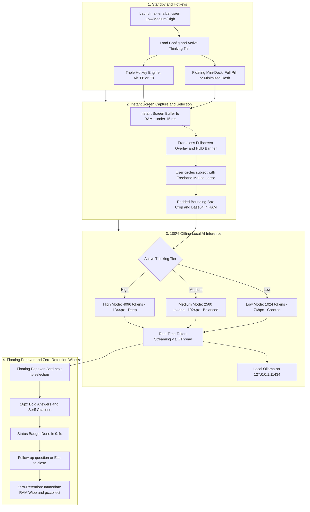

# AI Lens (100% Offline Screen Capture & Local VLM Assistant)

[](https://www.python.org/downloads/)
[](https://opensource.org/licenses/MIT)
[-orange)](https://ollama.com/)
[](#supported-language-shortcuts)
[](#thinking-depth--quality-tiers-low--medium--high)

**AI Lens** is a lightweight, 100% offline desktop screen-capture assistant designed for instantaneous screen analysis using local Vision-Language Models (VLMs) like `gemma4:latest`, `qwen2.5-vl`, or `minicpm-v`.

With a single hotkey (**`Alt + F8`**) or one click on the floating mini-dock, your screen is instantly frozen (< 15 ms). Circle any area with your mouse (lasso selection) to receive real-time streaming answers, question & puzzle solutions, fill-in-the-blank completions, code explanations, or translations from your local AI model—without sending a single byte outside your computer.

---

## How AI Lens Works (Project Architecture & Workflow)



---

## Key Features

- **100% Local & Private:** Runs entirely on `127.0.0.1` via local Ollama. Zero external cloud APIs, zero tracking, zero telemetry.
- **3 Configurable Thinking Depth & Quality Tiers (`Low`, `Medium`, `High`):**
  - Choose directly from the terminal (`ai-lens cs High`, `ai-lens en Medium`, `ai-lens Low`) how deeply the model thinks, how many tokens it can generate (`1024` / `2560` / `4096`), and what image resolution it inspects (`768px` / `1024px` / `1344px`).
  - Engineered to remain **lightweight enough to run locally even on weaker PCs** across all three tiers.
- **Smart Question, Sequence & Fill-in-the-Blank Solver:**
  - **Standard Questions & Quizzes:** Describes what is visible, **always provides the direct verified answer**, and **explains why** it is correct.
  - **Fill-in-the-Blank Sentences (`"něco je _____ proto"`, `...`, `___`):** Follows a strict two-step rule—**first** describes what is shown on the screen (without giving away the answer in the first sentence), and **second** provides the missing answer and explains why.
  - **Character-by-Character Sequence & Alphabet Verification:** Inspects characters and diacritics both **before** and **after** any blank `_` (e.g., recognizing that in `"abc_dď"` the letter `"d"` and `"ď"` are already present after the blank, so the missing Czech alphabet letter is **`č`**).
- **Enhanced Popover Typography & Citation Styling:**
  - **Highlighted Answers (`**...**`):** Rendered in the same clean text color (`#E5E7EB`), but **larger (`16px`) and extra bold (`font-weight: 800`)** so key answers stand out immediately.
  - **Citations (`"..."`):** Automatically enclosed in standard double quotes `""` and styled in an **italic serif citation font** (`Georgia`, `Cambria`, `Times New Roman`).
- **Full 15-Language Localization (AI Responses + Entire UI):**
  - Switching language (`ai-lens cs`, `ai-lens en`, `ai-lens de`, `ai-lens sk`, etc.) localizes **both** the AI's answers and **all UI elements**: generation time badges (`Hotovo · doba generování 12.0 s` / `Done · generation time 12.0 s`), thinking/streaming indicators, input placeholders, tooltips, and the top overlay HUD banner.
- **Ultra-Fast Capture (< 15 ms) & Triple-Engine Hotkeys:**
  - Captures the screen buffer directly into RAM with automatic high-DPI scaling (up to 4K+).
  - Supports **`Alt + F8`**, **`F8`**, **`Ctrl + Alt + Shift + G`**, and a draggable **Collapsible Mini-Dock** (`🔍 AI Lens [CS · Medium] (Alt+F8)`).
  - **Minimizes to a thin dash (`—` / "čárka"):** Click the `—` button or double-click to shrink the dock into a razor-thin 8px bar that covers nothing on screen. Click it once or double-click anywhere to expand it back!

---

## Thinking Depth, Answer Accuracy & Factual Context Tiers (`Low` / `Medium` / `High`)

You can control **answer accuracy**, **factual background context** (how much information you get when circling an animal, plant, object, or text), and **token/context capacity** by passing **`Low`**, **`Medium`**, or **`High`** directly in the terminal.

All three tiers run **100% locally on your hardware (even on weaker PCs with 8–16 GB RAM)**, allowing you to trade off **generation speed & temporary RAM usage** against **answer accuracy & richness of factual context**:

| Tier | CLI Command Example | Answer Accuracy & Factual Context (e.g. Circling an Animal, Object, or Text) | Tokens (`num_predict`) / Window (`num_ctx`) | Max Image Detail (`max_side`) | Typical Generation Time & Trade-Off |
|---|---|---|---|---|---|
| **`Low`** | `.\ai-lens.bat en Low`<br>`.\ai-lens.bat cs Low` | **Basic / Fast Accuracy & Concise Context (2–4 sentences):** Identifies the animal, plant, object, or text and gives 1–2 key facts or a direct summary. (`think=False`) | `1024` / `2048` tokens | `768 px` | **Fastest (~1–4 s), lowest RAM overhead.** Ideal for quick visual lookups or simple translations on weaker laptops. |
| **`Medium`** *(Default)* | `.\ai-lens.bat en Medium`<br>`.\ai-lens.bat cs Medium` | **High Accuracy & Balanced Factual Context (1–2 paragraphs):** When an animal/plant/object is circled, states its species/category, habitat/origin, diet/function, and key traits; for text/questions, explains meaning and context clearly. (`think=True`) | `2560` / `4096` tokens | `1024 px` | **Balanced (~5–12 s), moderate RAM usage.** High accuracy and informative context while keeping responses snappy. |
| **`High`** | `.\ai-lens.bat en High`<br>`.\ai-lens.bat cs High` | **Maximum Accuracy & Deep Encyclopedic Context:** Distinguishes look-alike species/objects/concepts, provides a rich encyclopedic profile (taxonomy, anatomy/features, habitat, diet/behavior, history/purpose, and interesting facts), and verifies tricky questions/blanks (`_`) step by step. (`think=True`) | `4096` / `8192` tokens | `1344 px` | **Maximum accuracy (~10–25 s), higher token & KV-cache RAM usage.** Inspects fine visual details and diacritics at high resolution and delivers comprehensive context. |

> [!NOTE]
> **Why does `High` take longer to generate?**
> In `High` mode, the local VLM processes a higher-resolution crop (`1344 px`), runs a deep multi-step verification pass, and generates a richer encyclopedic profile of the circled subject or problem. You pay with a few extra seconds of generation time and slightly more RAM during the query, and in return get maximum accuracy and comprehensive background information.

---

## Requirements

1. **Operating System:** Windows 10 / 11 (64-bit), Linux (X11 / Wayland), macOS.
2. **Python:** Python 3.10, 3.11, 3.12, or 3.13.
3. **Local AI Engine:** [Ollama](https://ollama.com/) running locally:
   ```bash
   ollama pull gemma4:latest
   # Or optionally for ultra-lightweight hardware:
   # ollama pull qwen2.5vl:3b
   ```

---

## Installation

You do **not** need a virtual environment (`venv`) to install and run AI Lens—after cloning and installing, you can launch it directly with a single command.

1. **Clone the repository:**
   ```bash
   git clone https://github.com/Jalop-end/ai-lens.git
   cd ai-lens
   ```

2. **Install dependencies directly:**
   ```powershell
   pip install -e .
   ```
   *(If `pip` is not on your PATH on Windows, use `py -m pip install -e .` or `python -m pip install -e .`)*

> [!TIP]
> **Using a Virtual Environment (`venv`) is Optional but Ideal:**
> While a `venv` is not required, using one is recommended if you want to keep project dependencies isolated from your global Python installation:
> ```powershell
> # Create virtual environment (use 'py -m venv .venv' on Windows if 'python' opens the MS Store)
> py -m venv .venv
>
> # Activate in PowerShell (bypass script execution policy for the current session if needed):
> Set-ExecutionPolicy -Scope Process -ExecutionPolicy Bypass
> .\.venv\Scripts\Activate.ps1
>
> # Or activate in CMD:
> .\.venv\Scripts\activate.bat
>
> pip install -e .
> ```

---

### Quick Start

### 1. Launch with Language & Thinking Depth (`Low` / `Medium` / `High`)
On Windows, you can launch AI Lens directly from PowerShell or Command Prompt using **`.\ai-lens.bat`** (or `.\ai-lens` in PowerShell, or `python -m ai_lens`). It works automatically whether you use a virtual environment or system Python.

Pass an optional language shortcut (`cs`, `en`, `de`, `sk`, etc.) and/or thinking tier (`Low`, `Medium`, `High`) in any order:

```powershell
# Launch in English with High thinking depth:
.\ai-lens.bat en High

# Launch in Czech with High thinking depth (best for tricky questions, sequences & puzzles):
.\ai-lens.bat cs High

# Launch in Czech with Medium thinking depth (default balanced mode):
.\ai-lens.bat cs Medium

# Launch in English with Low thinking depth (fastest on weaker laptops):
.\ai-lens.bat en Low

# Change only the thinking depth (keeps your current language):
.\ai-lens.bat High
.\ai-lens.bat Low

# (Optional) If you have an active virtual environment or installed package to PATH,
# you can also type 'ai-lens' directly:
# ai-lens en High
```

- A floating pill **`🔍 AI Lens [EN · High] (Alt+F8)`** appears in the top-right corner of your screen.
  - **Minimize to a thin dash (`—`):** Click the `—` button (or double-click the pill) to collapse it into a discreet 8px horizontal line that never covers tabs or text.
  - **Expand back:** Click the thin dash once (or double-click) to restore the full pill.
  - **Right-click menu:** Right-click either the pill or dash to minimize, expand, trigger capture, or quit.
- Press **`Alt + F8`** (or **`F8`**, or click the floating pill) and draw a circle with your left mouse button around any region.
- Press **`Esc`** or right-click anywhere to return to standby.

### 2. Immediate One-Shot Trigger
Trigger the overlay immediately without waiting for a hotkey:
```powershell
.\ai-lens.bat trigger
.\ai-lens.bat trigger en High
.\ai-lens.bat trigger cs Low
```

---

## Supported Language Shortcuts (Full AI + UI Localization)

Pass any language code directly to `.\ai-lens.bat` (e.g. `.\ai-lens.bat en High` or `.\ai-lens.bat de Medium`). Both the **AI response** and the **Popover UI** (including generation time badges, status text, and input placeholders) switch to that language:

| Code | Language | Example Command | Localized Completion Badge Example |
|---|---|---|---|
| `en` | English (Angličtina) | `.\ai-lens.bat en High` | `Done · generation time 12.0 s` |
| `cs` *(or `cz`)* | Czech (Čeština) — *Default* | `.\ai-lens.bat cs High` | `Hotovo · doba generování 12.0 s` |
| `sk` | Slovak (Slovenčina) | `.\ai-lens.bat sk High` | `Hotovo · doba generovania 12.0 s` |
| `de` | German (Deutsch) | `.\ai-lens.bat de Medium` | `Fertig · Generierungszeit 12.0 s` |
| `es` | Spanish (Español) | `.\ai-lens.bat es Medium` | `Listo · tiempo de generación 12.0 s` |
| `fr` | French (Français) | `.\ai-lens.bat fr Medium` | `Terminé · temps de génération 12.0 s` |
| `pl` | Polish (Polski) | `.\ai-lens.bat pl Medium` | `Gotowe · czas generowania 12.0 s` |
| `uk` *(or `ua`)* | Ukrainian (Українська) | `.\ai-lens.bat uk Medium` | `Готово · час генерації 12.0 с` |
| `it` | Italian (Italiano) | `.\ai-lens.bat it Medium` | `Fatto · tempo de generazione 12.0 s` |
| `pt` | Portuguese (Português) | `.\ai-lens.bat pt Medium` | `Concluído · tempo de geração 12.0 s` |
| `ru` | Russian (Русский) | `.\ai-lens.bat ru Medium` | `Готово · время генерации 12.0 с` |
| `nl` | Dutch (Nederlands) | `.\ai-lens.bat nl Medium` | `Klaar · generatietijd 12.0 s` |
| `zh` *(or `cn`)* | Chinese (中文) | `.\ai-lens.bat zh Medium` | `完成 · 生成用时 12.0 秒` |
| `ja` *(or `jp`)* | Japanese (日本語) | `.\ai-lens.bat ja Medium` | `完了 · 生成時間 12.0 秒` |
| `ko` *(or `kr`)* | Korean (한국어) | `.\ai-lens.bat ko Medium` | `완료 · 생성 시간 12.0초` |

---

## CLI Reference

Run via `.\ai-lens.bat <command>` (or `ai-lens <command>` if installed globally/with active venv):

| Command (Windows) | Description |
|---|---|
| `.\ai-lens.bat [lang] [Low\|Medium\|High]` | Starts AI Lens in standby mode with optional language & thinking depth (e.g., `.\ai-lens.bat en High`, `.\ai-lens.bat cs High`). |
| `.\ai-lens.bat start --now` | Starts the daemon and immediately opens the fullscreen capture overlay. |
| `.\ai-lens.bat trigger [lang] [level]` | Triggers the overlay on the running instance or runs a one-shot capture. |
| `.\ai-lens.bat diag` *(or `diagnostika`)* | Prints a live terminal report of active model, live RAM/CPU usage, `Low`/`Medium`/`High` accuracy & factual context specs, Zero-Retention RAM check, and 7-point security audit. |
| `.\ai-lens.bat levels` | Lists the `Low`, `Medium`, and `High` thinking tiers, answer accuracy, factual context depth, and token limits. |
| `.\ai-lens.bat languages` | Lists all 15 supported language codes and highlights the active language. |
| `.\ai-lens.bat status` | Displays the running state, active hotkey, model, language, and thinking level. |
| `.\ai-lens.bat stop` | Cleanly stops the running AI Lens background process. |
| `.\ai-lens.bat config` | Views or updates persistent settings in `config.json`. |

### Persistent Configuration Examples
```powershell
# Set English language and High thinking depth in config.json:
.\ai-lens.bat config --lang en --level High

# Set Czech language and Medium thinking depth:
.\ai-lens.bat config --lang cs --level Medium

# Change the local VLM model in Ollama:
.\ai-lens.bat config --model gemma4:latest

# Adjust selection bounding-box padding in pixels:
.\ai-lens.bat config --padding 20
```

---

## Specifications, Resource Usage & Live Security Diagnostics

You can view the live system specifications, RAM/CPU usage, `Low`/`Medium`/`High` accuracy & context profiles, Zero-Retention memory status, and 7-point security audit directly in your terminal at any time:

```powershell
# Run live diagnostics in PowerShell / CMD:
.\ai-lens.bat diag
# or in Czech:
.\ai-lens.bat diagnostika
```

For full technical documentation—including exact **RAM / VRAM / CPU consumption**, **`Low` / `Medium` / `High` factual context & accuracy parameters**, **Zero-Retention RAM erasure on chat close**, and the **Security & Threat Audit**—see [**`SPECIFICATIONS.md`**](SPECIFICATIONS.md).

---

## Project Structure

```text
ai-lens/
├── ai_lens/
│   ├── __init__.py          # Package metadata
│   ├── __main__.py          # Direct python -m ai_lens execution entry point
│   ├── cli.py               # Typer CLI with direct <lang> and <Low|Medium|High> shortcuts
│   ├── daemon.py            # Win32 background loop, triple hotkey engine, localized floating dock
│   ├── capture.py           # Sub-15ms screen capture & high-DPI bounding box crop
│   ├── overlay.py           # PyQt6 frameless fullscreen overlay with localized HUD & zero-retention RAM wipe
│   ├── popover.py           # Floating result card, styled HTML renderer (16px bold & serif quotes)
│   └── vision_engine.py     # Local Ollama QThread worker, loopback security guard, Low/Medium/High tiers
├── ai-lens.bat              # Universal Windows launcher (works with or without .venv)
├── config.json              # Persistent configuration (hotkey, model, language, thinking_level)
├── pyproject.toml           # Project dependencies and CLI entry point
├── SPECIFICATIONS.md        # Technical specs, RAM/CPU usage, Low/Medium/High context & security audit
├── .gitignore               # Clean git exclusions
└── README.md                # Documentation
```

---

## License & Model Attributions

This project's application source code is licensed under the [MIT License](LICENSE).

### Third-Party AI Models & Trademarks
AI Lens connects to locally hosted Vision-Language Models running on your machine via local Ollama inference. The model weights are separate works governed by their respective licenses:
- **Gemma / Gemma 4:** Developed and released by **Google LLC**. Gemma is an open-weights model governed by the [Google Gemma Terms of Use](https://ai.google.dev/gemma/terms) and [Gemma Prohibited Use Policy](https://ai.google.dev/gemma/prohibited_use_policy).
- **Qwen2.5-VL:** Developed by **Alibaba Cloud / Qwen Team**, released under the [Apache 2.0 License](https://github.com/QwenLM/Qwen2.5-VL/blob/main/LICENSE).

*Disclaimer: AI Lens is an independent open-source tool and is not affiliated with, sponsored by, or endorsed by Google LLC, Alibaba Cloud, or Ollama.*
