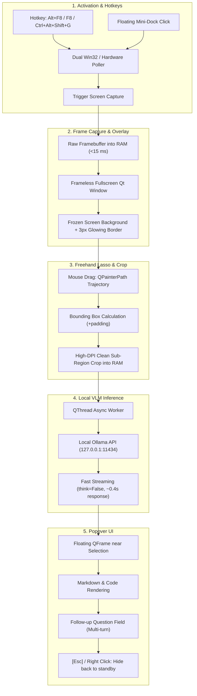

# AI Lens (100% Offline Screen Capture & Local VLM Assistant)

[](https://www.python.org/downloads/)
[](https://opensource.org/licenses/MIT)
[-orange)](https://ollama.com/)

**AI Lens** is a lightweight, 100% offline desktop screen-capture assistant designed for instantaneous screen analysis using local Vision-Language Models (VLMs) like `gemma4:latest`, `qwen2.5-vl`, or `minicpm-v`.

With a single hotkey (**`Alt + F8`**) or one click on the floating mini-dock, your screen is instantly frozen (< 15 ms). You can freely circle any area with your mouse (lasso selection), and receive real-time streaming answers, code explanations, error diagnoses, or translations from your local AI model—without sending a single byte outside your computer.

---

## Key Features

- **100% Local & Private:** Runs entirely on `127.0.0.1` via local Ollama. Zero external cloud APIs, zero tracking, zero telemetry.
- **Ultra-Fast Capture (< 15 ms):** Captures the screen buffer directly into RAM using high-performance screen capture with automatic high-DPI scaling (up to 4K+).
- **Freehand Lasso Tool:** Draw naturally around any text, terminal error, diagram, or UI element. The bounding box is automatically calculated with customizable padding.
- **Floating Popover Card:**
  - Displays real-time streaming tokens with Markdown and code block syntax rendering.
  - Smart collision detection: automatically repositions to prevent overflowing screen boundaries.
  - Interactive multi-turn follow-up question input at the bottom.
- **Triple-Engine Hotkey Detection:**
  - Supports **`Alt + F8`**, **`F8`**, and **`Ctrl + Alt + Shift + G`**.
  - Powered by native Win32 `RegisterHotKey`, a 15ms `GetAsyncKeyState` hardware key poller, and low-level keyboard hooks to guarantee responsiveness regardless of Windows language switches (`CS`/`EN`) or keyboard rollover limits.
- **Floating Mini-Dock:** A sleek, draggable floating pill (`AI Lens (Alt+F8)`) that provides 1-click mouse activation and visual confirmation that the assistant is running.
- **Firewall & Sandbox Friendly:** Zero listening TCP network ports opened by the application, eliminating Windows Defender Firewall blockages.
- **Console QuickEdit Protection:** Automatically disables Windows Console QuickEdit pause mode so clicking in the terminal never freezes background threads.

---

## Architecture Pipeline



---

## Requirements

1. **Operating System:** Windows 10 / 11 (64-bit), Linux (X11 / Wayland), macOS.
2. **Python:** Python 3.10, 3.11, 3.12, or 3.13.
3. **Local AI Engine:** [Ollama](https://ollama.com/) running locally:
   ```bash
   ollama pull gemma4:latest
   # Or optionally:
   # ollama pull qwen2.5vl:3b
   ```

---

## Installation

1. **Clone the repository:**
   ```bash
   git clone https://github.com/Jalop-end/ai-lens.git
   cd ai-lens
   ```

2. **Set up a virtual environment:**
   ```powershell
   python -m venv .venv
   .\.venv\Scripts\activate
   ```

3. **Install dependencies:**
   ```powershell
   pip install -e .
   ```

---

## Quick Start

### 1. Launch in Standby Mode (Recommended)
Run the convenience batch script or CLI command:
```powershell
.\ai-lens.bat
```
*(Or `python -m ai_lens` / `ai-lens start`)*

- A floating pill **`AI Lens (Alt+F8)`** will appear in the top-right corner of your screen.
- Press **`Alt + F8`** (or **`F8`**, or simply click the floating button).
- The screen freezes with a crisp white & cyan border and a top HUD banner.
- **Draw a circle** with your left mouse button around what you want to analyze.
- The popover card appears and streams the analysis in real time.
- Press **`Esc`** or right-click anywhere to dismiss the overlay and return to standby.

### 2. Immediate One-Shot Trigger
If you want to trigger the overlay directly without waiting for a hotkey:
```powershell
.\ai-lens.bat trigger
```

---

## CLI Reference

`ai-lens` provides a rich set of command-line tools:

| Command | Description |
|---|---|
| `ai-lens` / `ai-lens.bat` | Starts the daemon in standby mode with the floating dock and hotkey listener. |
| `ai-lens start --now` | Starts the daemon and immediately triggers the overlay on launch. |
| `ai-lens trigger` | Sends a trigger signal to the running instance, or opens the overlay directly. |
| `ai-lens status` | Displays the current running state, active hotkey, and configured model. |
| `ai-lens stop` | Cleanly stops the running AI Lens background process. |
| `ai-lens config` | Views or updates configuration parameters. |

### Configuration Options
You can configure options either in `config.json` or via CLI:
```powershell
# Change the local model
ai-lens config --model qwen2.5vl:3b

# Change the default hotkey
ai-lens config --hotkey "<alt>+<f8>"

# Adjust selection padding
ai-lens config --padding 15
```

---

## Project Structure

```text
ai-lens/
├── ai_lens/
│   ├── __init__.py          # Package metadata
│   ├── __main__.py          # Direct python -m ai_lens execution entry point
│   ├── cli.py               # Typer CLI commands (start, stop, status, trigger, config)
│   ├── daemon.py            # Win32 background loop, hotkey engine, floating dock
│   ├── capture.py           # Sub-15ms screen capture & high-DPI bounding box crop
│   ├── overlay.py           # PyQt6 frameless fullscreen overlay with lasso painter
│   ├── popover.py           # Floating result card, markdown renderer, collision detection
│   └── vision_engine.py     # Local Ollama stream worker (QThread), auto-start helper
├── ai-lens.bat              # Quick Windows launcher
├── config.json              # Configurable shortcuts, models, padding, and prompts
├── pyproject.toml           # Project dependencies and entry points
├── .gitignore               # Clean git exclusions
└── README.md                # English documentation
```

---

## License

This project is licensed under the [MIT License](LICENSE).
