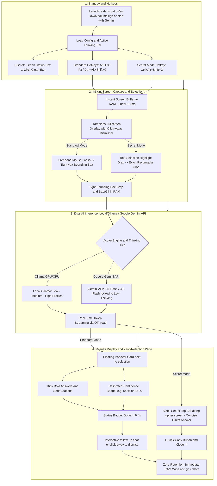

# AI Lens (100% Offline Screen Capture & Local VLM Assistant)

[](https://www.python.org/downloads/)
[](https://opensource.org/licenses/MIT)
[-orange)](https://ollama.com/)
[](https://ai.google.dev/)
[](#supported-language-shortcuts)
[](#boosted-thinking-depth-answer-accuracy--factual-context-tiers-low--medium--high)

**AI Lens** is a lightweight, 100% offline desktop screen-capture assistant designed for instantaneous screen analysis using local Vision-Language Models (VLMs) like `gemma4:latest`, `qwen2.5-vl`, or `minicpm-v`.

With a single hotkey (**`Alt + F8`** or **`Ctrl + Alt + Shift + G`**), Secret Quick-Answer Mode (**`Ctrl + Alt + Shift + Q`**), or clicking the discrete green indicator dot, your screen is instantly frozen (< 15 ms). Circle any area with your mouse or drag a text highlight to receive real-time streaming answers, quiz solutions, fill-in-the-blank completions, code explanations, or translations from your local AI model—without sending a single byte outside your computer.

---

## How AI Lens Works (Project Architecture & Workflow)



---

## Key Features

- **100% Local & Private by Default:** Runs entirely on `127.0.0.1` via local Ollama (GPU default, CPU switchable). Zero tracking, zero telemetry.
- **Optional Google Gemini API Mode (`start with Gemini`):**
  - Launch AI Lens with cloud multimodal intelligence by entering **`start with Gemini`** (or `.\ai-lens.bat start with Gemini`).
  - **100% RAM-Only Key Security:** Your Gemini API key is stored **strictly in short-term volatile memory (RAM)** for the running session. It is **never** written to `config.json`, logs, or disk. It must be entered each time and is automatically wiped on exit.
  - Ultra-fast real-time streaming via **`gemini-2.5-flash`** (with automatic fallback to `gemini-2.0-flash` / `gemini-1.5-flash`) with thinking budgets, full 15-language UI localization, and interactive follow-up chat.
- **GPU Accelerated by Default with Instant `CPU` / `@\` Terminal Switch:**
  - By default, AI Lens runs on your **GPU** offloading all layers directly to high-speed VRAM for maximum responsiveness and encyclopedic depth.
  - Switch to pure **CPU** execution anytime simply by appending **`CPU`** or **`@\`** to your command (e.g. `.\ai-lens.bat cs High CPU` or `.\ai-lens.bat cs Low CPU`).
  - **Dynamic Dual-Profile Tuning:** When running on CPU, AI Lens automatically applies a lightweight, responsive profile (shorter tokens, optimized crop, direct concise answers) to ensure fast completion in seconds instead of minutes.
- **3 Powerfully Boosted Thinking Depth & Factual Context Tiers (`Low`, `Medium`, `High`):**
  - **`Low`** on GPU is boosted to the power of former Medium (`2560` tokens / `4096` context window / `1024px` image / `think=False` for instant ~1.5–3 s streaming). On CPU, it delivers instant direct answers in ~1.5–3 s (`384` tokens / `think=False`).
  - **`Medium`** on GPU is expanded above former High (`4096` tokens / `8192` context window / `1280px` image / `think=True`). On CPU, it provides a balanced 1-paragraph summary in ~4–8 s (`768` tokens / `2560` context).
  - **`High`** on GPU is maximized for encyclopedic depth (`5120` tokens / `10240` context window / `1280px` image / `think=True`). On CPU, it provides thorough verification in ~8–15 s (`1280` tokens / `4096` context).
- **Calibrated Biological Recognition & Skeptical Animal Confidence Scores (`XX %`):**
  - **Strictly Calibrated for Animals & Domestic Breeds:** Distinguishing domestic cat breeds, mixed-breed dogs, or reptiles without close-up head scale/pupil details is challenging. AI Lens uses a skeptical, realistic probability range (**38–65%** for ambiguous look-alikes or partial views; **25–45%** if distant/blurry) and reserves high confidence (**85–95%**) exclusively for textbook unmistakable specimens with zero look-alikes (e.g., an adult male lion with full mane, giraffe, zebra).
  - Every probability estimate is followed by a **1-sentence rationale** explaining which visual traits confirmed the identification or which alternative look-alike species could not be ruled out.
  - Dynamically rendered in the Popover header as a clean, emoji-free badge (🟢 **≥85%**, 🔵 **70–84%**, 🟡 **<70%**).
- **Smart Question, Sequence & Fill-in-the-Blank Solver:**
  - **Standard Questions & Quizzes:** Describes what is visible, **always provides the direct verified answer**, and **explains why** it is correct.
  - **Fill-in-the-Blank Sentences (`"něco je _____ proto"`, `...`, `___`):** Follows a strict two-step rule—**first** describes what is shown on the screen (without giving away the answer in the first sentence), and **second** provides the missing answer and explains why.
  - **Character-by-Character Sequence & Alphabet Verification:** Inspects characters and diacritics both **before** and **after** any blank `_` (e.g., recognizing that in `"abc_dď"` the letter `"d"` and `"ď"` are already present after the blank, so the missing Czech alphabet letter is **`č`**).
- **Enhanced Popover Typography & Citation Styling:**
  - **Highlighted Answers (`**...**`):** Rendered in the same clean text color (`#E5E7EB`), but **larger (`16px`) and extra bold (`font-weight: 800`)** so key answers stand out immediately.
  - **Citations (`"..."`):** Automatically enclosed in standard double quotes `""` and styled in an **italic serif citation font** (`Georgia`, `Cambria`, `Times New Roman`).
- **Full 15-Language Localization (AI Responses + Entire UI):**
  - Switching language (`ai-lens cs`, `ai-lens en`, `ai-lens de`, `ai-lens sk`, etc.) localizes **both** the AI's answers and **all UI elements**: generation time badges, thinking/streaming indicators, input placeholders, tooltips, and the top overlay HUD banner.
- **Secret Quick-Answer Mode (`Ctrl + Alt + Shift + Q`):**
  - Instant direct quiz/question solver triggered by pressing **`Ctrl + Alt + Shift + Q`** (or `Ctrl + Shift + Alt + Q`, or `.\ai-lens.bat secret`).
  - **Pure Text-Selection Drag & Instant Vanishing Highlight:** Dragging your cursor highlights text just like marking text to copy in your browser or Word. The moment you release the mouse, the blue highlight **vanishes immediately**, leaving the screen completely clean, natural, and unmarked during AI inference.
  - **High-Visibility Glassmorphic Top Bar (`SecretTopBar`):** The streaming answer appears centered in a glassmorphic bar (`rgba(12, 20, 36, 135)`) positioned along the screen's top edge. Featuring bold 15px text and a soft ambient drop shadow, it remains sharply readable over both light and dark windows while maintaining sleek transparency.
  - **Smart Task-Aware Language Evaluation:**
    - If the selected text is a foreign language exercise (e.g. English fill-in-the-blank, grammar test, vocabulary cloze, or matching terms with definitions), the AI **does not translate the answer into Czech**—it fills the correct missing word or matching term directly in English (e.g. `"went"` instead of `"šla"`).
    - If the exercise explicitly asks for translation (e.g. *"Přeložte:"*, *"Translate into..."*), it provides the translated answer in the target language.
    - If the question is an ordinary general knowledge or descriptive inquiry (e.g. *"What is the speed of light?"*), it responds in the user's selected language (e.g. Czech).
  - **Deep Comprehension & Concise Direct Output:** Retains the exact same deep reasoning, OCR character verification, context analysis, and negations check as classic mode with active internal thinking, while presenting a concise, direct answer with minimal text (no filler, no essay).
  - **Zero Thoughts in UI (Background-Only Reasoning):** The model's internal thinking process stays strictly in the background and is never output as visible text in the Secret Top Bar or chat.
  - **Human-Friendly Chat Math (No Raw LaTeX):** Math formulas, equations, and calculations are automatically converted from raw LaTeX (`\text`, `\times`, `{,}`, `\frac`, `$`) into natural, clean chat-friendly format (e.g. `11 % × 0.81 = 8.91 % (0.0891)` or `x - 5`, `10 / 2 = 5`).
  - **Question Options Marking (✓ and ✗):** For any question with multiple options (A/B/C/D, True/False, etc.), correct options are marked with a small checkmark (`✓`) and wrong options with a cross (`✗`).
  - Includes a 1-click clipboard copy button and close button (`✕`), entirely free of emojis.
- **Ultra-Mini Green Dot Standby Indicator (Click to Exit):**
  - AI Lens displays an ultra-mini **7px glowing green dot** (`#22C55E`) anchored in the very top-right corner of your screen showing that AI Lens is running in the background.
  - **1-Click Clean Exit:** Hovering turns the dot red (`#EF4444`); clicking it immediately terminates the entire AI Lens background process and safely wipes all memory.
- **English Standby Banner & Diagnostic Logging:**
  - The startup standby status banner, daemon activations, screen freeze timings, RAM clearance confirmations, and API key wipe notices are all reported in English in the terminal.
  - When encountering API quota or rate-limiting (e.g. HTTP 429), the engine automatically falls back to lightweight models (`gemini-3.5-flash-lite`) while accurately reporting the original HTTP status code.
- **Smart Click-Away Overlay Dismissal:**
  - If a selection is complete or an answer card is showing, clicking anywhere outside the result card immediately dismisses/closes the overlay and frees RAM—preventing accidental re-selections or screen freeze.
- **Tight 4px Bounding Box Contour:**
  - AI Lens eliminates excess whitespace around selections, tightly framing the user's drawn lasso or text highlight with a compact **4px padding**, ensuring the AI focuses strictly on what you selected.
- **Ultra-Fast Capture (< 15 ms) & Multi-Engine Hotkeys:**
  - Captures the screen buffer directly into RAM with automatic high-DPI scaling (up to 4K+).
  - Supports standard hotkeys **`Alt + F8`**, **`F8`**, **`Ctrl + Alt + Shift + G`**, and Secret Mode **`Ctrl + Alt + Shift + Q`**.
  - Immediate dismissal with **`Esc`**, clicking outside the card, or right-clicking anywhere.

---

## Boosted Thinking Depth, Answer Accuracy & Factual Context Tiers (`Low` / `Medium` / `High`)

AI Lens features a **Dual-Profile Architecture**:
1. **GPU Profile (Default Acceleration):** Unleashes full encyclopedic power with thousands of tokens, expansive context, and deep multi-paragraph reasoning.
2. **CPU Profile (Optimized Lightweight Mode):** Automatically scales down token limits and context to match CPU memory bandwidth, ensuring answers complete in seconds (~1.5–15 s) instead of minutes, keeping the assistant responsive and lightweight.

---

### [1] GPU Profile (Default — Boosted Encyclopedic Depth)

When running on GPU (default hardware acceleration offloading all layers directly into VRAM), dedicated high-bandwidth memory (~300–1000 GB/s) and parallel tensor cores process tokens in milliseconds:

| Tier | CLI Command Example | Answer Accuracy & Factual Context (e.g. Circling an Animal, Object, or Text) | Tokens (`num_predict`) / Window (`num_ctx`) | Max Image Detail (`max_side`) | Typical Generation Time & Trade-Off |
|---|---|---|---|---|---|
| **`Low`** *(Boosted & Bleskový)* | `.\ai-lens.bat en Low`<br>`.\ai-lens.bat cs Low` | **High Accuracy & Balanced Context (1–2 paragraphs):** Boosted to former Medium tokens! Direct instant answers without lengthy hidden thought pause (`think=False`). | `2560` / `4096` tokens | `1024 px` | **Bleskový (~1.5–3 s on GPU), minimal RAM overhead (~350–500 MB).** Great everyday balance. |
| **`Medium`** *(Expanded above former High)* | `.\ai-lens.bat en Medium`<br>`.\ai-lens.bat cs Medium` | **Very High Accuracy & Deep Context (2–3 paragraphs):** Exceeds the former High tier. Thorough visual verification, taxonomy/origin, comprehensive diet/mechanics, and step-by-step reasoning (`think=True`). | `4096` / `8192` tokens | `1280 px` | **High detail (~4–8 s on GPU), moderate KV-cache (~600–800 MB).** Recommended for most analytical tasks. |
| **`High`** *(Maximally Boosted Encyclopedic Depth)* | `.\ai-lens.bat en High`<br>`.\ai-lens.bat cs High` | **Maximum Accuracy & Encyclopedic Profile:** Distinguishes look-alikes and tricky variants, provides exhaustive biological profiles (species, subspecies, look-alike comparisons, anatomical details, behavior, history) with deep reasoning (`think=True`). | `5120` / `10240` tokens | `1280 px` *(fine details & diacritics without memory bloat)* | **Deepest reasoning (~6–14 s on GPU).** Bounded memory footprint (~800–1100 MB KV cache) prevents RAM starvation. |

> [!NOTE]
> **RAM Safety on Weak PCs:**
> Even in `High` mode with 10,240 context tokens, AI Lens explicitly bounds Ollama's context allocation (`num_ctx: 10240`), preventing Ollama from defaulting to a 65,536-token context (~10 GB overhead). This ensures smooth local execution without freezing system memory.

---

### [2] CPU Profile (Optimized Lightweight Mode — Instant & Responsive)

When running on CPU (append **`CPU`** or **`@\`** to your command, e.g. `.\ai-lens.bat cs High CPU`), AI Lens dynamically switches to a specially tuned lightweight profile. Answers are more direct and concise, but generation finishes in seconds rather than hanging your system:

| Tier | CLI Command Example | Answer Accuracy & Factual Context on CPU | Tokens (`num_predict`) / Window (`num_ctx`) | Max Image Detail (`max_side`) | Typical Generation Time on CPU |
|---|---|---|---|---|---|
| **`Low`** *(Bleskový / Instant)* | `.\ai-lens.bat en Low CPU`<br>`.\ai-lens.bat cs Low CPU` | **Basic Fast & Direct (1–2 sentences):** Direct answer without lengthy internal thinking (`think=False`). Best when you just need the solution, missing word, or translation instantly. | `384` / `1536` tokens | `640 px` | **Ultra-fast (~1.5–3 s on CPU).** Minimal CPU load, instant response. |
| **`Medium`** *(Vyvážený / Balanced)* | `.\ai-lens.bat en Medium CPU`<br>`.\ai-lens.bat cs Medium CPU` | **Good Balanced Summary (1 paragraph):** Concise identification, key visual traits, function, and verified answer with fast internal reasoning (`think=True`). | `768` / `2560` tokens | `768 px` | **Svižný (~4–8 s on CPU).** Great balance between speed and factual depth. |
| **`High`** *(Hloubkový / Detailed)* | `.\ai-lens.bat en High CPU`<br>`.\ai-lens.bat cs High CPU` | **High Accuracy with Concise Context (1–2 paragraphs):** Thorough verification of tricky details and fill-ins, explaining the exact rationale while keeping text length optimized for CPU execution (`think=True`). | `1280` / `4096` tokens | `896 px` | **Důkladný (~8–15 s on CPU).** High accuracy without stalling the processor. |

---

### Why CPU Local AI Inference is Slower than GPU (Hardware & Architecture Bottleneck)

Users often ask: *"Why does local AI run so much slower on a CPU than on a GPU, and why does CPU mode use shorter answers?"*

1. **Memory Bandwidth Bottleneck (The #1 Limiting Factor):**
   - In modern autoregressive Large Language Models (LLMs / VLMs), generating **every single token** requires reading the entire model weight matrix (~3.5 to 5.5 GB for Gemma 4) from memory.
   - Dedicated GPUs feature specialized high-bandwidth VRAM (GDDR6 or HBM) providing **300 to 1,000 GB/s** of throughput. A GPU can stream the entire 5 GB model through its matrix multipliers in just ~10–25 ms per token (delivering **40–80 tokens/second**).
   - In contrast, standard PC system RAM (DDR4 or DDR5) only provides **25 to 60 GB/s** of memory bandwidth—**10× to 20× slower**. The CPU spends over 90% of its execution time idle, memory-bound, waiting for weights to travel across the motherboard memory bus into the L3 cache. This limits CPU generation speed to ~**4–8 tokens/second**.
2. **Massive Parallelism vs. General-Purpose Cores:**
   - A modern GPU contains **thousands of specialized tensor/CUDA cores** designed specifically to perform parallel matrix multiplications (FP16 / INT4 dot-products) simultaneously.
   - A desktop CPU contains only **8 to 16 high-power general-purpose cores**. Even with SIMD vector extensions (AVX2 / AVX-512), a CPU cannot match the sheer mathematical throughput of thousands of GPU cores.
3. **Internal Thinking (`<thought>`) Multiplication:**
   - When a model generates 300 tokens of internal reasoning followed by 500 tokens of encyclopedic output (800 tokens total):
     - **On GPU:** At 60 tok/s, 800 tokens take only **~13 seconds**.
     - **On CPU:** At 5 tok/s, 800 tokens would take **160 seconds (almost 3 minutes!)**.
   - **The AI Lens Solution:** By reducing the context window and token ceiling on CPU (and turning off internal thought on `Low`), AI Lens cuts token generation down to what is strictly necessary. Instead of waiting 3 minutes, you get a verified, accurate answer in **1.5 to 15 seconds**!

---

## Requirements

1. **Operating System:** Windows 10 / 11 (64-bit), Linux (X11 / Wayland), macOS.
2. **Python:** Python 3.10, 3.11, 3.12, or 3.13.
3. **Local AI Engine:** [Ollama](https://ollama.com/) running locally:
   ```bash
   ollama pull gemma4:latest
   # Or optionally for ultra-lightweight hardware:
   # ollama pull qwen2.5vl:3b
   ```

---

## Installation

You do **not** need a virtual environment (`venv`) to install and run AI Lens—after cloning and installing, you can launch it directly with a single command.

1. **Clone the repository:**
   ```bash
   git clone https://github.com/Jalop-end/ai-lens.git
   cd ai-lens
   ```

2. **Install dependencies directly:**
   ```powershell
   pip install -e .
   ```
   *(If `pip` is not on your PATH on Windows, use `py -m pip install -e .` or `python -m pip install -e .`)*

> [!TIP]
> **Using a Virtual Environment (`venv`) is Optional but Ideal:**
> While a `venv` is not required, using one is recommended if you want to keep project dependencies isolated from your global Python installation:
> ```powershell
> # Create virtual environment (use 'py -m venv .venv' on Windows if 'python' opens the MS Store)
> py -m venv .venv
>
> # Activate in PowerShell (bypass script execution policy for the current session if needed):
> Set-ExecutionPolicy -Scope Process -ExecutionPolicy Bypass
> .\.venv\Scripts\Activate.ps1
>
> # Or activate in CMD:
> .\.venv\Scripts\activate.bat
>
> pip install -e .
> ```

---

### Quick Start

### 1. Launch with Google Gemini API (`.\ai-lens.bat start with Gemini`)
The single and official command to start AI Lens in Google Gemini API mode is:

```powershell
.\ai-lens.bat start with Gemini
```
*(Or in an active virtual environment: `start with Gemini`)*

#### Subscription Tier Gate (Paid vs. Free Quota)
When starting Gemini API mode, AI Lens first asks whether you have a paid Google Cloud / AI Studio subscription with billing enabled:

```text
Do you have a paid Google Cloud / AI Studio subscription with billing enabled? [y/N]: 
```

**Why this step is important:**
Advanced preview models such as **`gemini-3.8-flash`**, **`gemini-3.1-pro`**, and **`gemini-3.5-flash`** require a Google Cloud account with billing enabled. Free-tier API keys lack quota for these preview models and return `403 Forbidden` or `429 Quota Exceeded`. To guarantee a seamless experience without errors, AI Lens customizes the model selection table based on your subscription:

1. **If YES (`y` / paid subscription with billing enabled):**
   - **`[1] gemini-2.5-flash`** — **Gemini 2.5 Flash** *(Recommended)*: Next-gen lightning-fast multimodal model with reasoning (thinking). High precision, instant response.
   - **`[2] gemini-3.1-pro`** — **Gemini 3.1 Pro** *(Complex Reasoning)*: Advanced flagship model for intricate code, deep logic, mathematics, and complex analysis.
   - **`[3] gemini-3.5-flash`** — **Gemini 3.5 Flash** *(High Intelligence & Speed)*: Next-gen multimodal model balancing high intelligence with responsive real-time generation.
   - **`[4] gemini-3.8-flash`** — **Gemini 3.8 Flash** *(Currently Out of Working)*: Kept in the table for reference, but currently disabled / out of working due to upstream API preview latency and rate-limit issues. Cannot be selected.
   - **`[5] gemini-3.5-flash-lite`** — **Gemini 3.5 Flash-Lite** *(Ultra-Lightweight)*: Lightest, most cost-efficient preview model designed for minimal latency and high query volume.
   - **`[6] custom`** — **Custom Model ID**: Enter any Google Gemini model identifier manually.

2. **If NO (`n` / default free tier):**
   - **`[1] gemini-2.5-flash`** — **Gemini 2.5 Flash** *(Recommended)*: Standard free quota available. Lightning-fast multimodal model with reasoning support.
   - **`[2] gemini-3.5-flash-lite`** — **Gemini 3.5 Flash-Lite** *(Lightweight)*: Standard free quota available. Ultra-lightweight model with lowest latency and generous rate limits.
   - **`[3] custom`** — **Custom Model ID**: Enter any custom Google Gemini model identifier manually.

---

#### Understanding Gemini 3.8 Flash Speed & Thinking Tokens
Users often ask: *"Why does Gemini 3.8 Flash sometimes take longer or appear to just be loading compared to 2.5 Flash? Shouldn't it be just as fast?"*

1. **Reasoning & Thinking Token Generation:**
   - **`gemini-3.8-flash`** is a specialized reasoning model with deep thinking capabilities. Unlike non-thinking models, it explores hypotheses and validates deductions by generating **internal thought tokens** before emitting the first word of the final answer.
   - If thinking level is set to maximum (`high`), the model may generate several thousand reasoning tokens behind the scenes. During this time, no visible text is emitted yet, so the UI displays the loading indicator (`*Model is thinking...*`).
2. **API Schema Optimization (`thinkingLevel` vs. `thinkingBudget`):**
   - While Gemini 2.5 uses `thinkingBudget: <int>`, Gemini 3.x models (`3.8`, `3.5`, `3.1`) use `thinkingLevel: "low" | "medium" | "high"` and reject `thinkingBudget` with HTTP 400 Bad Request.
   - **AI Lens Speed Optimization:** To deliver near-instant responses on `Low` and `Medium` thinking tiers, AI Lens automatically sets `thinkingLevel: "low"` for Gemini 3.x models. This restricts the internal reasoning loop and delivers verified answers in **~1.5 to 2.5 seconds**, matching Gemini 2.5 Flash speed! For deep encyclopedic reasoning, selecting `High` allows Gemini 3.8 Flash to unleash full multi-step thinking.
3. **Automatic Fallback Protection:**
   - If a requested model is unavailable or rate-limited on your key (`403` / `404` / `429`), AI Lens automatically falls back to `gemini-2.5-flash` or `gemini-3.5-flash-lite` so your workflow is never interrupted.

---

#### Strict RAM-Only API Key Security (Zero Disk Retention)
After choosing your model, AI Lens prompts for your Gemini API key in the terminal:
- **Instant Online Verification:** The key is tested live with Google's `/v1beta/models` endpoint.
- **100% Volatile RAM Storage:** Your API key is stored **strictly in process memory (RAM)**.
- **Zero Disk Persistence:** The key is **never** written to `config.json`, logs, cache, or disk.
- **Instant Auto-Purge:** The moment you exit AI Lens (pressing `[Esc]`, clicking `✕`, or typing `stop`), the key is immediately erased from memory via `clear_volatile_gemini_api_key()` and Python garbage collection (`gc.collect()`).

---

### 2. Launch Local VLM with Language & Thinking Depth (`Low` / `Medium` / `High`)
On Windows, you can launch AI Lens directly from PowerShell or Command Prompt using **`.\ai-lens.bat`** (or `.\ai-lens` in PowerShell, or `python -m ai_lens`). It works automatically whether you use a virtual environment or system Python.

Pass an optional language shortcut (`cs`, `en`, `de`, `sk`, etc.) and/or thinking tier (`Low`, `Medium`, `High`) in any order:

```powershell
# Launch in English with High thinking depth on GPU (default):
.\ai-lens.bat en High

# Launch in Czech with High thinking depth on GPU:
.\ai-lens.bat cs High

# Switch execution to CPU on demand (add 'CPU' or '@\'):
.\ai-lens.bat cs High CPU
.\ai-lens.bat cs Low CPU
.\ai-lens.bat en Medium CPU
# Alternatively using the '@\' symbol:
.\ai-lens.bat cs High @\
.\ai-lens.bat cs High "@\"

# Launch in Czech with Medium thinking depth (default balanced mode on GPU):
.\ai-lens.bat cs Medium

# Launch in English with Low thinking depth (fastest everyday GPU mode):
.\ai-lens.bat en Low

# Change only the thinking depth (keeps your current language):
.\ai-lens.bat High
.\ai-lens.bat Low

# (Optional) If you have an active virtual environment or installed package to PATH,
# you can also type 'ai-lens' directly:
# ai-lens en High
```

> [!TIP]
> **GPU vs. CPU Execution (`CPU` or `@\` Switch):**
> - **GPU is default:** AI Lens automatically runs with GPU acceleration enabled (`num_gpu: -1`).
> - **CPU Switch (`CPU` / `@\`):** Simply append **`CPU`** (e.g. `.\ai-lens.bat cs High CPU`) or **`@\`** (in PowerShell with quotes `.\ai-lens.bat cs High "@\"`) to run on pure CPU (`num_gpu: 0`).
> - When running on CPU, the lightweight CPU profile is automatically activated, keeping responses lightning-fast (1.5–15 s).

- A discrete **14px green status dot** appears in the top-right corner of your screen indicating that AI Lens is active in standby.
  - **1-Click Clean Exit:** Hovering turns the dot red (`#EF4444`); clicking it immediately shuts down AI Lens and clears memory.
- Press **`Alt + F8`** (or **`F8`** / **`Ctrl + Alt + Shift + G`**) and draw a tight selection around any region with your left mouse button.
- Press **`Ctrl + Alt + Shift + Q`** to activate **Secret Quick-Answer Mode**: drag a rectangular text highlight and get a concise direct answer streaming directly on the top bar.
- Click anywhere outside the result card, press **`Esc`**, or right-click to return to standby and instantly wipe RAM.

### 2. Immediate One-Shot Trigger & Secret Mode
Trigger the overlay immediately from the command line:
```powershell
# Standard lasso capture:
.\ai-lens.bat trigger
.\ai-lens.bat trigger en High
.\ai-lens.bat trigger cs Low

# Secret Quick-Answer Mode (concise direct answer, top bar):
.\ai-lens.bat secret
.\ai-lens.bat secret en Low
.\ai-lens.bat trigger --secret
```

---

## Supported Language Shortcuts (Full AI + UI Localization)

Pass any language code directly to `.\ai-lens.bat` (e.g. `.\ai-lens.bat en High` or `.\ai-lens.bat de Medium`). Both the **AI response** and the **Popover UI** (including generation time badges, status text, and input placeholders) switch to that language:

| Code | Language | Example Command | Localized Completion Badge Example |
|---|---|---|---|
| `en` | English (Angličtina) | `.\ai-lens.bat en High` | `Done · generation time 12.0 s` |
| `cs` *(or `cz`)* | Czech (Čeština) — *Default* | `.\ai-lens.bat cs High` | `Hotovo · doba generování 12.0 s` |
| `sk` | Slovak (Slovenčina) | `.\ai-lens.bat sk High` | `Hotovo · doba generovania 12.0 s` |
| `de` | German (Deutsch) | `.\ai-lens.bat de Medium` | `Fertig · Generierungszeit 12.0 s` |
| `es` | Spanish (Español) | `.\ai-lens.bat es Medium` | `Listo · tiempo de generación 12.0 s` |
| `fr` | French (Français) | `.\ai-lens.bat fr Medium` | `Terminé · temps de génération 12.0 s` |
| `pl` | Polish (Polski) | `.\ai-lens.bat pl Medium` | `Gotowe · czas generowania 12.0 s` |
| `uk` *(or `ua`)* | Ukrainian (Українська) | `.\ai-lens.bat uk Medium` | `Готово · час генерації 12.0 с` |
| `it` | Italian (Italiano) | `.\ai-lens.bat it Medium` | `Fatto · tempo de generazione 12.0 s` |
| `pt` | Portuguese (Português) | `.\ai-lens.bat pt Medium` | `Concluído · tempo de geração 12.0 s` |
| `ru` | Russian (Русский) | `.\ai-lens.bat ru Medium` | `Готово · время генерации 12.0 с` |
| `nl` | Dutch (Nederlands) | `.\ai-lens.bat nl Medium` | `Klaar · generatietijd 12.0 s` |
| `zh` *(or `cn`)* | Chinese (中文) | `.\ai-lens.bat zh Medium` | `完成 · 生成用时 12.0 秒` |
| `ja` *(or `jp`)* | Japanese (日本語) | `.\ai-lens.bat ja Medium` | `完了 · 生成時間 12.0 秒` |
| `ko` *(or `kr`)* | Korean (한국어) | `.\ai-lens.bat ko Medium` | `완료 · 생성 시간 12.0초` |

---

## CLI Reference

Run via `.\ai-lens.bat <command>` (or `ai-lens <command>` if installed globally/with active venv):

| Command (Windows) | Description |
|---|---|
| `.\ai-lens.bat start with Gemini` | Starts AI Lens in **Google Gemini API** mode (prompts for paid subscription tier, presents the model table, and securely verifies your volatile RAM key). |
| `.\ai-lens.bat [lang] [Low\|Medium\|High]` | Starts AI Lens in local VLM standby mode on GPU (e.g., `.\ai-lens.bat en High`, `.\ai-lens.bat cs High`). |
| `.\ai-lens.bat start --now` | Starts the daemon and immediately opens the fullscreen capture overlay. |
| `.\ai-lens.bat trigger [lang] [level]` | Triggers standard lasso overlay on the running instance or runs a one-shot capture. |
| `.\ai-lens.bat secret` *(or `trigger -s`)* | Triggers **Secret Quick-Answer Mode** (text-selection highlight, concise direct answer on top bar). |
| `.\ai-lens.bat diag` *(or `diagnostika`)* | Prints a live terminal report of active model, live RAM/CPU usage, `Low`/`Medium`/`High` accuracy & factual context specs, Zero-Retention RAM check, and 7-point security audit. |
| `.\ai-lens.bat levels` | Lists the `Low`, `Medium`, and `High` thinking tiers, answer accuracy, factual context depth, and token limits. |
| `.\ai-lens.bat languages` | Lists all 15 supported language codes and highlights the active language. |
| `.\ai-lens.bat status` | Displays the running state, active hotkey, model, language, and thinking level. |
| `.\ai-lens.bat stop` | Cleanly stops the running AI Lens background process. |
| `.\ai-lens.bat config` | Views or updates persistent settings in `config.json`. |

### Persistent Configuration Examples
```powershell
# Set English language and High thinking depth in config.json:
.\ai-lens.bat config --lang en --level High

# Set Czech language and Medium thinking depth:
.\ai-lens.bat config --lang cs --level Medium

# Change the local VLM model in Ollama:
.\ai-lens.bat config --model gemma4:latest

# Adjust selection bounding-box padding in pixels:
.\ai-lens.bat config --padding 20
```

---

## Specifications, Resource Usage & Live Security Diagnostics

You can view the live system specifications, RAM/CPU usage, `Low`/`Medium`/`High` accuracy & context profiles, Zero-Retention memory status, and 7-point security audit directly in your terminal at any time:

```powershell
# Run live diagnostics in PowerShell / CMD:
.\ai-lens.bat diag
# or in Czech:
.\ai-lens.bat diagnostika
```

For full technical documentation—including exact **RAM / VRAM / CPU consumption**, **`Low` / `Medium` / `High` factual context & accuracy parameters**, **Zero-Retention RAM erasure on chat close**, and the **Security & Threat Audit**—see [**`SPECIFICATIONS.md`**](SPECIFICATIONS.md).

---

## Project Structure

```text
ai-lens/
├── ai_lens/
│   ├── __init__.py          # Package metadata
│   ├── __main__.py          # Direct python -m ai_lens execution entry point
│   ├── cli.py               # Typer CLI with direct <lang> and <Low|Medium|High> shortcuts
│   ├── daemon.py            # Win32 background loop, triple hotkey engine, localized floating dock
│   ├── capture.py           # Sub-15ms screen capture & high-DPI bounding box crop
│   ├── overlay.py           # PyQt6 frameless fullscreen overlay with localized HUD & zero-retention RAM wipe
│   ├── popover.py           # Floating result card, styled HTML renderer (16px bold & serif quotes)
│   └── vision_engine.py     # Local Ollama QThread worker, loopback security guard, Low/Medium/High tiers
├── ai-lens.bat              # Universal Windows launcher (works with or without .venv)
├── config.json              # Persistent configuration (hotkey, model, language, thinking_level)
├── pyproject.toml           # Project dependencies and CLI entry point
├── SPECIFICATIONS.md        # Technical specs, RAM/CPU usage, Low/Medium/High context & security audit
├── .gitignore               # Clean git exclusions
└── README.md                # Documentation
```

---

## License & Model Attributions

This project's application source code is licensed under the [MIT License](LICENSE).
Copyright (c) 2026 Jalop-end. All rights reserved.

For comprehensive intellectual property, third-party library licenses, API terms of use, and model acknowledgements, please see the [**`NOTICE`**](NOTICE) file.

### Third-Party AI Cloud Services & APIs
AI Lens provides an optional client interface to connect to Google Cloud AI services. When operating in Gemini mode:
- **Google Gemini API:** Google Gemini, Gemini 2.5 Flash, Gemini 3.1 Pro, Gemini 3.5 Flash, Gemini 3.8 Flash, and Gemini 3.5 Flash-Lite are services of **Google LLC**. Use of the Gemini API is governed by the [Google APIs Terms of Service](https://developers.google.com/terms) and the [Google AI Studio / Gemini API Additional Terms of Service](https://ai.google.dev/gemini-api/terms).
- **RAM-Only Key Security:** AI Lens never redistributes, bundles, or persists user API keys to disk. All queries are initiated directly from the user's client machine to Google's official endpoints over HTTPS.

### Third-Party Local AI Models & Weights
AI Lens connects to locally hosted Vision-Language Models running on your machine via local Ollama inference (`127.0.0.1:11434`). The model weights are separate works governed by their respective licenses:
- **Google Gemma / Gemma 4:** Developed and released by **Google LLC**. Governed by the [Google Gemma Terms of Use](https://ai.google.dev/gemma/terms) and [Gemma Prohibited Use Policy](https://ai.google.dev/gemma/prohibited_use_policy).
- **Qwen2.5-VL:** Developed by **Alibaba Cloud / Qwen Team**, released under the [Apache 2.0 License](https://github.com/QwenLM/Qwen2.5-VL/blob/main/LICENSE).
- **MiniCPM-V:** Developed by **OpenBMB / ModelBest Inc.**, released under the [Apache 2.0 License / MiniCPM Model License](https://github.com/OpenBMB/MiniCPM-V/blob/main/LICENSE).

### Third-Party Software Libraries
This product links to and utilizes open-source components including **PyQt6 / Qt** (Riverbank Computing / The Qt Company, GPLv3/LGPLv3), **httpx** (BSD-3-Clause), **Pillow** (HPND License), **mss** (MIT License), **pynput** (LGPLv3), **numpy** (BSD-3-Clause), and **typer** (MIT License). See [**`NOTICE`**](NOTICE) for complete copyright notices.

### Disclaimer
*AI Lens is an independent open-source tool and is NOT affiliated with, sponsored by, authorized by, or endorsed by Google LLC, Alibaba Cloud, OpenBMB, Riverbank Computing, The Qt Company, or Ollama. All trademarks, service marks, and trade names referenced herein belong to their respective owners.*
