# AI Lens 🔍
### Instant Offline Screen Capture & Local Vision-Language Assistant

[](https://www.python.org/downloads/)
[](https://opensource.org/licenses/MIT)
[-orange)](https://ollama.com/)
[](https://ai.google.dev/)
[](https://github.com/Jalop-end/ai-lens)
[](#-supported-languages-full-ui--ai-localization)
[%20%7C%20Low%2FMed%2FHigh%20(Local)-blueviolet)](#mode-a-google-gemini-api)
[](#-performance-benchmarks--hardware-notice)

**AI Lens** is an ultra-fast desktop screen-capture assistant engineered for instantaneous screen analysis using either 100% offline local Vision-Language Models (e.g. `gemma4:latest`, `qwen2.5-vl`, `minicpm-v`) or Google Gemini cloud intelligence.

With a single hotkey (**`Alt + F8`** / **`Ctrl + Alt + Shift + G`**), Secret Quick-Answer Mode (**`Ctrl + Alt + Shift + Q`**), or clicking the discrete green indicator dot, your screen is instantly frozen (< 15 ms). Circle any area or highlight text to receive real-time streaming answers, quiz solutions, code analysis, or translations—with sub-5s response streaming, NumPy-accelerated preprocessing, unified High-reasoning depth, and zero data retention.

---

## 📑 Table of Contents

- [⚡ Quick Start](#-quick-start)
  - [Windows](#windows)
  - [macOS & Linux](#macos--linux)
- [🎯 Modes & Features Comparison](#-modes--features-comparison)
- [🚀 Launch Modes](#-launch-modes)
  - [Mode A: Google Gemini API (Unified High Reasoning, 12K Tokens & Smart Quota Guard)](#mode-a-google-gemini-api)
  - [Mode B: Local VLM (GPU vs. CPU Thinking Tiers)](#mode-b-local-vlm-thinking-tiers)
- [🏎️ Performance & Psychological UX Enhancements](#️-performance--psychological-ux-enhancements)
  - [NumPy Vectorized Auto-Trim (< 1.5 ms)](#1-numpy-vectorized-background-auto-trim--15-ms)
  - [Luminous Infinity Loop Animation (∞)](#2-luminous-infinity-loop-animation--lemniscate)
  - [40-Second Hard Watchdog Safeguard](#3-40-second-hard-watchdog-safeguard)
  - [Salvaged Thought Recovery](#4-salvaged-thought-recovery)
- [⌨️ Hotkeys & Gestures](#-hotkeys--shortcuts)
- [🌐 Supported Languages (15)](#-supported-languages-full-ui--ai-localization)
- [💻 CLI Reference](#-cli-reference)
- [📁 Project Directory Layout](#-project-directory-layout)
- [🛡️ Security, Privacy & Zero-Retention](#-security-privacy--zero-retention)
- [🧠 Architecture, Brain & Processing Pipeline](#-architecture-brain--processing-pipeline)
- [⚡ Performance Benchmarks & Hardware Notice](#-performance-benchmarks--hardware-notice)
- [📜 License & Attributions](#-license--attributions)

---

## ⚡ Quick Start

### Windows

1. **Clone repository & install dependencies:**
   ```powershell
   git clone https://github.com/Jalop-end/ai-lens.git
   cd ai-lens
   pip install -e .
   ```

2. **Launch immediately:**
   ```powershell
   # Mode 1: Cloud Intelligence with Google Gemini API (Unified High Thinking)
   .\ai-lens.bat start with Gemini

   # Mode 2: 100% Offline Local Model (Default: GPU Acceleration)
   .\ai-lens.bat cs High          # Czech, High thinking depth
   .\ai-lens.bat en High          # English, High thinking depth

   # Mode 3: Lightweight CPU Mode (for laptops / integrated graphics)
   .\ai-lens.bat cs Low CPU       # Fast CPU inference in 1.5–3 seconds
   ```

---

### macOS & Linux

1. **Clone repository & run one-time setup:**
   ```bash
   git clone https://github.com/Jalop-end/ai-lens.git
   cd ai-lens
   pip install -e .
   chmod +x *.sh ai-lens start
   ./setup-mac.sh                 # Registers convenient system-wide aliases
   ```

2. **Launch immediately:**
   ```bash
   # Mode 1: Cloud Intelligence with Google Gemini API
   ./ai-lens.sh start with Gemini
   # or simply:
   ./start with Gemini

   # Mode 2: Local Model (GPU / Apple Silicon Metal acceleration)
   ./ai-lens.sh cs High
   ./ai-lens.sh en High

   # Mode 3: Lightweight CPU Mode
   ./ai-lens.sh cs Low CPU
   ```

---

## 🎯 Modes & Features Comparison

AI Lens offers two purpose-built modes depending on whether you need deep encyclopedic study or rapid, discreet answers:

| Feature / Property | Standard Mode (Lasso) | Secret Mode (Quick-Answer) |
|---|---|---|
| **Primary Hotkey (Win)** | **`Alt + F8`** or **`Ctrl + Alt + Shift + G`** or **`F8`** | **`Ctrl + Alt + Shift + Q`** (or `Ctrl + Shift + Alt + Q`) |
| **Primary Hotkey (Mac)** | **`Option + F8`** or **`Cmd + Shift + G`** or **`F8`** | **`Cmd + Option + Shift + Q`** (or `Cmd + Shift + Option + Q`) |
| **CLI Launch** | `.\ai-lens.bat trigger` | `.\ai-lens.bat secret` |
| **Selection Gesture** | **Freehand mouse lasso** around any screen element | **Text-selection drag** (like selecting text in browser/Word) |
| **Selection Visibility** | Smooth animated contour with 4px tight crop | **Vanishes immediately upon mouse release** (screen stays 100% clean) |
| **Bounding Box FX** | Pulsing cyan outline with violet glowing corner brackets `┌ ┐ └ ┘` | Zero visible box on screen |
| **Display Interface** | Floating `PopoverCard` anchored next to selection | Glassmorphic `SecretTopBar` along top screen edge |
| **Thinking Animation** | **Luminous Infinity Loop (∞)** with dual celestial photons | Synchronized progress glow bar |
| **Reasoning & Depth** | **Comprehensive & deep:** Unified High thinking, rich citations, follow-up chat | **Strict max 25 words:** Direct verified answer only, zero filler |
| **Thinking in UI** | Shown in collapsible thought block (when enabled) | **Zero thoughts in UI:** Real-time stream filter strips all thought blocks |
| **Math Formatting** | Clean human-readable equations | **Human-friendly chat math:** (e.g. `11 % × 0.81 = 8.91 %` or `x - 5`) |
| **Question Options** | Detailed rationale of each choice (`✓` / `✗`) | **Smart checkmarks:** Correct marked with `✓`, incorrect with `✗` |
| **Language Logic** | Follows configured app language | **Context-aware:** Fills exercises in original language; direct answer otherwise |
| **Watchdog Safeguard** | **40 s hard timeout** with graceful warning badge | **40 s hard timeout** with auto-dismissal |
| **Dismissal & RAM** | Click outside, press `Esc`, or right-click to wipe | Click `✕`, copy button, or click outside to instantly wipe RAM |

---

## 🚀 Launch Modes

### Mode A: Google Gemini API

Launch with:
```powershell
.\ai-lens.bat start with Gemini     # Windows
./ai-lens.sh start with Gemini      # macOS / Linux
```

#### 1. Unified High Thinking & Model Lineup
All active Gemini models run in **unified `High` reasoning mode** with an expanded **`12,288` token ceiling** (`maxOutputTokens: 12288`), ensuring that deep thinking thoughts never truncate visible answers:

| Model ID | Tier Availability | Role / Specialization | Reasoning Mode (`thinkingConfig`) | Token Ceiling (`maxOutputTokens`) |
|---|---|---|---|---|
| **`gemini-3.5-flash`** *(Recommended)* | **Free & Gemini Pro** | Next-generation multimodal model balancing frontier intelligence with blazing sub-5s response. | **Unified High:** `thinkingLevel: "high"` | **12 288 tokens** |
| **`gemini-3.1-pro`** | **Gemini Pro (with Quota Guard)** | Flagship Pro model for complex code, advanced mathematics, STEM logic, and deep analysis. | **Unified High:** `thinkingLevel: "high"` + Pro Directive | **12 288 tokens** |
| **`gemini-3.5-flash-lite`** | **Free & Gemini Pro** | Ultra-lightweight model with lowest latency and highest request throughput. | **Unified High:** `thinkingLevel: "high"` | **12 288 tokens** |
| **`gemini-3.8-flash`** | *(Currently Disabled)* | *Temporarily locked due to upstream preview rate limits and latency.* | Disabled in selector | — |
| **`custom`** | **Free & Gemini Pro** | Enter any custom Google Gemini model identifier dynamically. | Dynamically configured | User-specified |

> [!IMPORTANT]
> ### 🛡️ Zero-Crash Smart Quota Guard
> - **Zero-Quota-Waste Startup:** Model availability is validated via `GET /v1beta/models` (**consuming 0 RPM / 0 token quota**), never burning requests during startup.
> - **Zero-Crash Pro 429 Protection:** If your API key selects `[2] Gemini 3.1 Pro` but lacks paid Pro quota (`HTTP 429 limit: 0`), AI Lens **never crashes** and never outputs an error message. Instead, it immediately routes the query through the highest-capability active Gemini 3 endpoint in High thinking mode while preserving the Pro reasoning directive.
> - **UI/RAM Permanence:** Your chosen model selection remains locked in RAM and UI throughout your session.

#### 2. Strict RAM-Only API Key Security & Masked Input
- **Masked Console Paste (`*`):** Supports `Ctrl+V` and right-click pasting with asterisk masking for both classic **`AIza...`** (39-char) and modern **`AQ....`** (53-char) Google Gemini API keys, automatically stripping invisible browser/clipboard formatting characters while rejecting malformed non-ASCII input.
- **HTTPS Header-Only Transport:** Transmitted exclusively in the `x-goog-api-key` header (never in URL query strings) with automatic secret redaction in all error and debug outputs.
- **100% Volatile Memory & Auto-Wipe:** Stored **strictly in process RAM** (never written to `config.json`, logs, or disk) and immediately wiped with `gc.collect()` upon exit.

---

### Mode B: Local VLM (Thinking Tiers: GPU vs. CPU)

Launch with:
```powershell
.\ai-lens.bat [language] [Low|Medium|High] [CPU]
```

AI Lens features an intelligent **Dual-Profile Architecture**:

#### 1. GPU Acceleration Profile (Default)
Offloads all neural network layers and KV-cache directly into VRAM for maximum encyclopedic depth and rich answers (+25% text tokens):

| Tier | Tokens (`num_predict`) | Context (`num_ctx`) | Image Resolution | Thinking Loop | Typical Response Time |
|---|---|---|---|---|---|
| **`Low`** | **3 200 tokens** | 5 120 tokens | 1024 px | `think=False` | **~1.5 – 3 seconds** (instant start) |
| **`Medium`** | **5 120 tokens** | 10 240 tokens | 1280 px | `think=True` | **~4 – 8 seconds** (thorough reasoning) |
| **`High`** | **6 400 tokens** | 12 800 tokens | 1280 px | `think=True` | **~6 – 14 seconds** (exhaustive depth) |

#### 2. CPU Lightweight Profile (Add `CPU` or `@\`)
When running on CPU (e.g. `.\ai-lens.bat cs Low CPU`), AI Lens automatically activates an ultra-efficient profile designed to prevent system lag and deliver verified answers in seconds:

| Tier | Tokens (`num_predict`) | Context (`num_ctx`) | Image Resolution | Thinking Loop | Typical Response Time on CPU |
|---|---|---|---|---|---|
| **`Low`** | **480 tokens** | 1 920 tokens | 640 px | `think=False` | **~1.5 – 3 seconds** (ultra-fast direct answer) |
| **`Medium`** | **960 tokens** | 3 200 tokens | 768 px | `think=True` | **~4 – 8 seconds** (balanced 1–2 paragraphs) |
| **`High`** | **1 600 tokens** | 5 120 tokens | 896 px | `think=True` | **~8 – 15 seconds** (thorough verification) |

---

## 🏎️ Performance & Psychological UX Enhancements

### 1. NumPy Vectorized Background Auto-Trim (< 1.5 ms)
When selecting text or UI regions with a mouse, users often capture redundant surrounding margins. AI Lens incorporates a sub-1.5ms NumPy preprocessor (`auto_trim_uniform_background_numpy`):
- **Vectorized Color Slicing:** Evaluates image perimeter variance and identifies active content masks in memory via high-speed 2D NumPy operations.
- **ViT Patch Pruning:** Automatically trims uniform whitespace and solid background while preserving a protective 16px glyph padding.
- **Latency Reduction:** Shrinks input Vision Transformer (ViT) patch count by **10–35%**, slashing Gemini and local VLM processing time down to **under 5 seconds**!

### 2. Luminous Infinity Loop Animation (∞ Lemniscate)
Extended reasoning queries require visual reassurance that the AI is actively thinking rather than frozen:
- **Continuous Bernoulli Lemniscate:** Custom anti-aliased mathematical curve with glowing cyan and indigo neon conduit.
- **Dual Breathing Cores:** Pulsing ambient radial gradients positioned in the left and right focal centers.
- **Twin Celestial Photons:** Orbital light particles circulating along the infinity path with comet trails, accompanied by live thinking-token pulse feedback.
- **Corner Brackets:** The frozen selection outline displays pulsing cyan borders and futuristic corner brackets (`┌ ┐ └ ┘`).

### 3. 40-Second Hard Watchdog Safeguard
Network stalls and upstream provider delays are guarded by a strict 40-second wall-clock timer:
- Automatically terminates queries exceeding 40 seconds.
- Displays a clean, localized timeout badge (`Vypršel limit 40 s`) rather than crashing or freezing your desktop.

### 4. Salvaged Thought Recovery
If a model reasons extensively through internal thoughts but stream connectivity closes without a separate text chunk, AI Lens's heuristic conclusion extractor analyzes the thought log, salvages the final deduction, and outputs it directly to the user.

---

## ⌨️ Hotkeys & Shortcuts

| Action | Windows Shortcut | macOS Shortcut | Description |
|---|---|---|---|
| **Standard Lasso Capture** | **`Alt + F8`** or **`Ctrl + Alt + Shift + G`** or **`F8`** | **`Option + F8`** or **`Cmd + Shift + G`** or **`F8`** | Freehand mouse lasso; opens PopoverCard with +25% rich depth and Infinity Animation. |
| **Secret Quick-Answer Mode** | **`Ctrl + Alt + Shift + Q`** | **`Cmd + Option + Shift + Q`** | Text-selection highlight drag; opens Glassmorphic SecretTopBar (strict max 25 words, zero thoughts). |
| **Dismiss / Cancel** | **`Esc`** or Right-Click | **`Esc`** or Two-Finger Tap | Immediately closes overlay and flushes RAM. |
| **Clean Process Exit** | **Click Green Dot** (or `Ctrl + C`) | **Click Green Dot** (or `Ctrl + C`) | Turns red on hover; safe `[y/N]` exit confirmation (`N` returns cleanly to standby). |

---

## 🌐 Supported Languages (Full UI + AI Localization)

Pass any language code as a launch argument (e.g. `.\ai-lens.bat de High` or `.\ai-lens.bat cs Medium`). Both the **AI answers** and the **entire desktop UI** (status badges, timer badges, placeholders) localize instantly:

| Code | Language | Native Name | Code | Language | Native Name |
|---|---|---|---|---|---|
| **`cs`** *(default)* | Czech | Čeština | **`it`** | Italian | Italiano |
| **`en`** | English | English | **`pt`** | Portuguese | Português |
| **`sk`** | Slovak | Slovenčina | **`ru`** | Russian | Русский |
| **`de`** | German | Deutsch | **`nl`** | Dutch | Nederlands |
| **`es`** | Spanish | Español | **`zh`** | Chinese | 中文 |
| **`fr`** | French | Français | **`ja`** | Japanese | 日本語 |
| **`pl`** | Polish | Polski | **`ko`** | Korean | 한국어 |
| **`uk`** | Ukrainian | Українська | | | |

---

## 💻 CLI Reference

| Command (Windows) | Command (macOS / Linux) | Action & Description |
|---|---|---|
| `.\ai-lens.bat start with Gemini` | `./ai-lens.sh start with Gemini` | Starts AI Lens in **Google Gemini API** mode with interactive model selector & unified High thinking. |
| `.\ai-lens.bat [lang] [Low\|Medium\|High]` | `./ai-lens.sh [lang] [level]` | Starts local VLM daemon with specified language and thinking tier on GPU. |
| `.\ai-lens.bat [lang] [level] CPU` | `./ai-lens.sh [lang] [level] CPU` | Starts local VLM daemon with lightweight CPU profile. |
| `.\ai-lens.bat secret` | `./ai-lens.sh secret` | Triggers **Secret Quick-Answer Mode** immediately. |
| `.\ai-lens.bat trigger` | `./ai-lens.sh trigger` | Triggers standard lasso overlay immediately. |
| `.\ai-lens.bat diag [lang]` | `./ai-lens.sh diag [lang]` | Prints real-time system diagnostics in chosen language (e.g. `diag en`, `diag cs`, or `en diag`). |
| `.\ai-lens.bat levels` | `./ai-lens.sh levels` | Displays detailed parameters for `Low`, `Medium`, and `High` tiers. |
| `.\ai-lens.bat languages` | `./ai-lens.sh languages` | Lists all 15 supported languages and shows the currently active language. |
| `.\ai-lens.bat status` | `./ai-lens.sh status` | Checks if background daemon is running. |
| `.\ai-lens.bat stop` | `./ai-lens.sh stop` | Gracefully terminates background daemon and clears memory. |
| `.\ai-lens.bat config --lang cs` | `./ai-lens.sh config --lang cs` | Persistently updates defaults in `config.json`. |

---

## 📁 Project Directory Layout

The codebase is organized into clean, modular layers with dedicated platform subfolders:

```text
ai-lens/
├── ai_lens/                 # Core Python application package
│   ├── cli.py               # Typer CLI with cross-platform commands and shortcuts
│   ├── daemon.py            # Win32/POSIX background daemon, hotkeys, status dock
│   ├── capture.py           # Sub-15ms screen capture & high-DPI bounding box crop
│   ├── overlay.py           # PyQt6 frameless fullscreen overlay, pulsing box & 40s watchdog
│   ├── popover.py           # PopoverCard, NeuralOrbWidget (∞ animation), SecretTopBar
│   └── vision_engine.py     # NumPy auto-trim, unified High thinking, quota guard, VLM client
├── scripts/                 # Platform-specific helpers and shortcuts
│   ├── windows/             # Windows scripts (CPU.bat, GPU.bat, Gemini.bat, enable-cpu-syntax.ps1)
│   └── mac/                 # macOS/Linux scripts (setup-mac.sh, CPU.sh, GPU.sh, Gemini.sh)
├── ai-lens.bat              # Primary Windows entry point
├── ai-lens.sh / ai-lens     # Primary macOS / Linux entry point
├── start.bat / start.sh     # Quick start launchers (e.g. start with Gemini)
├── setup-mac.sh             # Quick macOS shell integration setup
├── enable-cpu-syntax.ps1    # PowerShell integration bridge
├── config.json              # Persistent user configuration
├── pyproject.toml           # Project dependencies & build configuration
├── SPECIFICATIONS.md        # Detailed technical specifications (Czech)
└── README.md                # Project documentation & reference
```

---

## 🛡️ Security, Privacy & Zero-Retention

AI Lens is built with strict privacy and defensive security standards:

- **Zero-Retention RAM Policy:** Screen captures, crop buffers, and prompt history are held exclusively in RAM during active interaction. The moment the result window is closed (`[Esc]`, right-click, or `✕`), all image handles are closed and memory is immediately reclaimed via `gc.collect()`.
- **Zero Disk Persistence:** No screenshots, temporary images, or conversation logs are ever written to disk or `%TEMP%`.
- **Strict SSRF & Localhost Enforcement:** The Ollama client validates host URLs to ensure requests only route to local loopback (`127.0.0.1`, `localhost`).
- **Proxy Bypass Immunity:** HTTP clients enforce `trust_env=False`, ignoring system-level `HTTP_PROXY` redirects to prevent MitM snooping.
- **XSS & Link Hardening:** Markdown output is strictly HTML-escaped before display, and all external navigation links are disabled.
- **Volatile Gemini Key Storage & Header-Only Transport:** Masked `*` console input supports both `AIza...` and `AQ....` keys strictly in process RAM, transmitted exclusively via the `x-goog-api-key` HTTPS header (never in URLs or logs), with automatic secret redaction and instant wipe on shutdown.

For complete audit logs and threat vector analysis, see [**`SPECIFICATIONS.md`**](SPECIFICATIONS.md).

---

## 🧠 Architecture, Brain & Processing Pipeline

```mermaid
flowchart LR
    subgraph S1 ["1. Standby & Triggers"]
        direction TB
        CLI["CLI / Daemon"] --> CFG["Config & Tiers"]
        CFG --> HK["Hotkeys:<br/>Alt+F8 / Ctrl+Alt+Shift+Q"]
        CFG --> DOT["Green Dot / Ctrl+C<br/>([y/N] safe exit)"]
    end

    subgraph S2 ["2. Capture, Auto-Trim & RAM"]
        direction TB
        HK --> CAP["Freeze Screen<br/>(&lt;15ms in RAM)"]
        CAP --> OVR["Fullscreen Overlay"]
        OVR -->|"Standard"| LASSO["Lasso Selection"]
        OVR -->|"Secret"| RECT["Text Drag Highlight"]
        LASSO --> NUMPY["NumPy Auto-Trim<br/>(Prunes background &lt;1.5ms)"]
        RECT --> NUMPY
        NUMPY --> CROP["Base64 RAM Buffer"]
    end

    subgraph S3 ["3. AI Brain Engine (Unified High)"]
        direction TB
        CROP --> ROUTE{"Engine Router"}
        ROUTE -->|"Local Ollama"| LOCAL["Ollama VLM (GPU/CPU)<br/>Low / Med / High"]
        ROUTE -->|"Google Gemini"| CLOUD["Gemini 3.5 Flash & 3.1 Pro<br/>Unified High (12K Tokens)<br/>+ Smart Quota Guard"]
    end

    subgraph S4 ["4. Display & RAM Wipe"]
        direction TB
        LOCAL --> DISP["Stream Response"]
        CLOUD --> DISP
        DISP -->|"Standard"| POP["PopoverCard<br/>+ Infinity Animation (∞)"]
        DISP -->|"Secret"| BAR["SecretTopBar (max 25 words)"]
        POP --> WIPE["Zero-Retention Wipe<br/>(RAM cleared, gc.collect)"]
        BAR --> WIPE
    end

    S1 ==> S2 ==> S3 ==> S4
```

<details>
<summary><b>📐 Compact Application Architecture & Data Flow (Click to expand diagram)</b></summary>
<br>



</details>

<details>
<summary><b>🧠 Processing Pipeline: How the AI Lens Brain Works (Click to expand)</b></summary>
<br>

1. **Step 1: Low-Latency Event Interception (< 1 ms)**
   - Uses native Win32 `RegisterHotKey` / `GetAsyncKeyState` on Windows or POSIX signals / `pynput` on macOS and Linux.
   - Zero CPU overhead in standby (~0.0% CPU, 45–65 MB RAM).
2. **Step 2: Instant Screen Freeze (< 15 ms)**
   - Captures the exact display framebuffer using high-speed screen APIs directly into RAM.
   - Automatically handles multi-monitor coordinates and DPI scaling (100% to 200%+ up to 4K).
3. **Step 3: Vectorized NumPy Auto-Trim & Bounding-Box Selection**
   - **Standard Mode:** User draws a lasso around any UI element, object, diagram, or text.
   - **Secret Mode:** User drags a rectangular text highlight. The moment the mouse button is released, the highlight **completely vanishes**—leaving the screen 100% clean and unmodified.
   - **NumPy Matrix Slicing:** Evaluates image perimeter variance and trims redundant uniform background margins in ~0.5–1.5 ms while preserving a 16px border.
   - Encoded directly in memory as a base64 buffer without touching disk.
4. **Step 4: AI Brain Processing (Unified High Reasoning)**
   - **Local VLM (Ollama):** Applies system prompt guards against prompt injection, bounds KV-cache allocation, and dynamically configures thinking budgets.
   - **Google Gemini API:** Dynamically configures `{"thinkingLevel": "high"}` and `maxOutputTokens: 12288` across all active models (`gemini-3.5-flash`, `gemini-3.1-pro`, `gemini-3.5-flash-lite`).
   - **Smart Quota Guard:** Intercepts `429 (limit: 0)` errors on flagship Pro models and seamlessly routes through active Gemini 3 endpoints without dropping thinking depth or showing errors.
5. **Step 5: High-Precision Formatting, Typography & Animations**
   - **Luminous Infinity Animation (∞):** Renders dynamic Bernoulli lemniscate glowing path and circulating photons in PopoverCard during reasoning.
   - **Pulsing Corner Brackets:** Bounding box displays glowing cyan border and violet brackets (`┌ ┐ └ ┘`).
   - Answers formatted in bold 16px text (`#E5E7EB`), citations in serif italic font, LaTeX equations converted into natural chat math (e.g. `11 % × 0.81 = 8.91 %`), and multiple-choice options marked with `✓` and `✗`.
   - Secret Mode enforces a strict max 25-word direct answer and strips all internal thought blocks in real time.
6. **Step 6: Zero-Retention RAM Wipe**
   - Upon pressing `[Esc]`, clicking the copy/close button, or clicking outside the card, all image buffers, history dictionaries, and Qt documents are cleared, followed by immediate Python garbage collection (`gc.collect()`).

</details>

---

## ⚡ Performance Benchmarks & Hardware Notice

### Typical Speed & Latency Benchmarks

| Pipeline Stage | Local GPU (RTX 3060 / 4060) | Local CPU (8–16 Cores) | Cloud (Google Gemini 3.5 Flash) |
|---|---|---|---|
| **Screen Capture & Freeze** | **< 15 ms** | **< 15 ms** | **< 15 ms** |
| **NumPy Auto-Trim & Crop** | **< 2 ms** | **< 2 ms** | **< 2 ms** |
| **Time to First Token (TTFT)** | **~0.5 – 1.5 s** | **~1.0 – 2.5 s** | **~0.4 – 1.0 s** *(network latency)* |
| **Generation Speed** | **40 – 80 tokens/sec** | **4 – 8 tokens/sec** | **80 – 120 tokens/sec** |
| **Total Query Time (`Low`)** | **~1.5 – 3 s** | **~1.5 – 3 s** *(compact tokens)* | **~1.5 – 2.5 s** |
| **Total Query Time (`Medium`)** | **~4 – 8 s** | **~4 – 8 s** *(compact tokens)* | **~2.5 – 4 s** |
| **Total Query Time (`High`)** | **~6 – 14 s** | **~8 – 15 s** *(compact tokens)* | **~3 – 5 s** *(NumPy accelerated!)* |
| **RAM Footprint (Standby)** | **45 – 65 MB** | **45 – 65 MB** | **45 – 65 MB** |
| **RAM / VRAM (During Query)** | **+ 350 – 1100 MB VRAM** | **+ 150 – 600 MB RAM** | **+ 20 – 40 MB RAM** |
| **Cleanup & Memory Wipe** | **< 20 ms** | **< 20 ms** | **< 20 ms** |

---

> [!IMPORTANT]
> ### ⚠️ Critical Notice: Local AI Duration Depends on Your Hardware
> 
> The generation times listed above (e.g. `1.5–3 s` on `Low`, `4–8 s` on `Medium`, `6–14 s` on `High`) are **real-world benchmarks measured on standard modern hardware** (e.g., NVIDIA RTX 3060/4060, Apple Silicon M2/M3, PCIe Gen4 NVMe SSD, and 3200+ MHz RAM).
> 
> **Because local AI runs 100% on your computer, actual generation duration will vary according to your hardware:**
> 
> 1. **GPU Architecture & VRAM Bandwidth:**
>    - High-end GPUs (RTX 4070/4080/4090, Apple M-Pro/Max) with 300–1000 GB/s memory bandwidth process tokens at **60–100+ tokens/s**, completing even deep encyclopedic queries in a few seconds.
>    - Entry-level GPUs (GTX 1650, RTX 3050 mobile) or older graphics cards with narrow 64-bit or 128-bit memory buses (~100–190 GB/s) will take proportionally longer (~1.5× to 2.5× longer).
> 2. **CPU Mode & System RAM Speed (DDR4 vs. DDR5):**
>    - When running with `CPU` or `@\`, the primary hardware bottleneck is **system memory bandwidth**. Modern dual-channel DDR5 RAM (5600–6400 MT/s) will run almost **twice as fast** as older single-channel DDR4 RAM (2400–2666 MT/s).
>    - Number of CPU cores also matters: modern 8–16 core CPUs with AVX2/AVX-512 extensions will deliver 6–10 tokens/s, whereas 4-core mobile laptop CPUs may generate 2–4 tokens/s.
> 3. **Cold Start vs. Warm Cache:**
>    - The **very first query** after starting Ollama or booting your computer may take an additional **2 to 6 seconds** while model weights (~3.5–5.5 GB) are loaded from your disk into RAM/VRAM.
>    - All **subsequent queries** remain cached in memory and run at full instant speed. (Running on a fast NVMe SSD minimizes cold-start delay compared to an HDD).
> 4. **Cloud Gemini API Mode:**
>    - Does **not** use your local GPU or CPU. Performance is virtually identical on any computer and depends solely on your internet connection and Google Cloud API latency.
> 5. **Sub-5s Streaming via NumPy Auto-Trim:**
>    - Redundant background whitespace is cropped in `< 1.5 ms`, reducing the tokens transmitted to Gemini and accelerating answers down to ~3–5 seconds even on High reasoning depth.

---

## 📜 License & Attributions

- **Code License:** [MIT License](LICENSE) © 2026 Jalop-end.
- **Google Gemini API:** Google Gemini services are governed by the [Google APIs Terms of Service](https://developers.google.com/terms) and [Gemini Additional Terms](https://ai.google.dev/gemini-api/terms).
- **Model Weights:** Google Gemma (Gemma Terms of Use), Qwen2.5-VL (Apache 2.0), MiniCPM-V (Model License).
- **Libraries:** PyQt6 (Riverbank / Qt Company), httpx, Pillow, mss, pynput, typer, numpy. See [**`NOTICE`**](NOTICE) for full legal disclosures.

*Disclaimer: AI Lens is an independent open-source tool and is not affiliated with or endorsed by Google LLC, Alibaba Cloud, OpenBMB, or The Qt Company.*
