# Technické specifikace, spotřeba zdrojů a bezpečnostní audit (AI Lens)

Komplexní technická dokumentace desktopové aplikace **AI Lens**, přehled podporovaných modelů (lokální Ollama i Google Gemini API), hardwarové nároky na **RAM / VRAM / CPU**, parametry režimů myšlení (**`Low` / `Medium` / `High`**), rychlostní benchmarky s hardwarovou závislostí, životní cyklus dat v paměti (**Zero-Retention RAM Policy**) a výsledky **bezpečnostního auditu systému**.

---

## 📑 Obsah

- [⚡ Rychlý přehled klíčových parametrů](#-rychlý-přehled-klíčových-parametrů)
- [1. Architektura, mozek aplikace a běhový cyklus](#1-architektura-mozek-aplikace-a-běhový-cyklus)
  - [Grafické schéma architektury a toku dat](#-grafické-schéma-architektury-a-toku-dat)
  - [Mozek aplikace: 6 fází zpracování](#-mozek-aplikace-6-fází-zpracovatelského-pipeline)
  - [Srovnání režimů: Standardní mód vs. Secret mód](#srovnání-režimů-standardní-mód-vs-secret-mód)
  - [Běh na pozadí, signály a zelená mini-tečka](#běh-na-pozadí-signály-a-zelená-mini-tečka)
- [2. Specifikace AI modelů](#2-specifikace-ai-modelů)
  - [Lokální VLM modely v Ollamě](#lokální-vlm-modely-v-ollamě)
  - [Google Gemini API modely a Billing Guard](#google-gemini-api-modely-a-billing-guard)
- [3. Rychlostní parametry, benchmarky a závislost na hardwaru](#3-rychlostní-parametry-benchmarky-a-závislost-na-hardwaru)
  - [Tabulka odezvy a rychlosti generování](#tabulka-rychlostních-parametrů-a-odezvy)
  - [Důležité upozornění: Proč rychlost lokální AI závisí na vašem PC](#důležité-upozornění-proč-doba-odpovědi-lokální-ai-závisí-na-vašem-pc)
- [4. Spotřeba systémových prostředků (RAM, VRAM, CPU)](#4-spotřeba-systémových-prostředků-ram-vram-cpu)
  - [A. Klientská aplikace AI Lens (Python proces)](#a-klientská-aplikace-ai-lens-python-proces)
  - [B. Výpočetní engine (GPU akcelerace vs. odlehčené CPU)](#b-výpočetní-engine-gpu-akcelerace-vs-odlehčené-cpu)
- [5. Úrovně myšlení, přesnost a kontext (Low / Medium / High)](#5-úrovně-myšlení-přesnost-a-kontext-low--medium--high)
  - [GPU Profil (Maximální encyklopedický výkon)](#gpu-profil-výchozí-akcelerace--maximální-encyklopedický-výkon)
  - [CPU Profil (Odlehčený režim pro rychlou odezvu)](#cpu-profil-odlehčený-režim-pro-rychlou-odezvu)
  - [Kalibrovaná pravděpodobnost a skepse u plemen (XX %)](#kalibrovaná-pravděpodobnost-a-skepse-u-plemen-xx-)
- [6. Nulové uchovávání dat (Zero-Retention RAM Policy)](#6-nulové-uchovávání-dat-zero-retention-ram-policy)
- [7. Bezpečnostní audit a ochrana proti napadnutelnosti](#7-bezpečnostní-audit-a-ochrana-proti-napadnutelnosti)
- [8. Příkazový řádek a diagnostika (Windows & macOS / Linux)](#8-příkazový-řádek-a-diagnostika-windows--macos--linux)
- [9. Právní doložka, licence a autorská práva](#9-právní-doložka-licence-a-autorská-práva)

---

## ⚡ Rychlý přehled klíčových parametrů

| Parametr | Specifikace | Poznámka |
|---|---|---|
| **Doba zmrazení obrazovky** | **< 15 ms** | Bleskový celoobrazovkový snímek přímo do RAM (podpora až 4K+ high-DPI). |
| **Běžná spotřeba RAM (Standby)** | **45 – 65 MB** | V paměti běží pouze lehký Win32/POSIX listener a zelená mini-tečka. |
| **Podporované platformy** | **Windows 10/11, macOS, Linux** | Nativní Win32 zprávy i POSIX signály (`SIGUSR1`, `SIGUSR2`, `SIGTERM`). |
| **Lokální inference (Výchozí)** | **Ollama (`127.0.0.1:11434`)** | 100% offline, GPU akcelerace nebo odlehčené CPU profily. |
| **Cloudová inference (Volitelná)**| **Google Gemini API** | Modely 2.5 Flash, 3.1 Pro, 3.5 Flash s ochranou Billing Guard. |
| **Ukládání dat na disk** | **0 bajtů (Zero Disk Retention)** | Snímky, výřezy ani API klíče se **nikdy nezapisují na disk**. |
| **Zabezpečení Gemini API klíče** | **100% Volatile RAM** | Zadáno v terminálu, žije pouze v RAM, okamžitý výmaz při ukončení. |

---

## 1. Architektura, mozek aplikace a běhový cyklus

Aplikace běží jako plně lokální desktopový systém rozdělený do dvou oddělených vrstev komunikujících přes lokální rozhraní:
1. **Klientská GUI & Capture vrstva (`ai_lens/` v Pythonu + PyQt6):** Zajišťuje globální klávesové zkratky, sub-15ms snímek obrazovky, kreslení lasa či textového zvýraznění a vykreslování streamovaných odpovědí.
2. **Inference vrstva:** Lokální Ollama (`127.0.0.1:11434`) nebo cloudové rozhraní Google Gemini API.

---

### 📐 Grafické schéma architektury a toku dat

```mermaid
flowchart LR
    subgraph S1 ["1. Standby & Spouštěče"]
        direction TB
        CLI["CLI / Démon"] --> CFG["Konfigurace & Úrovně"]
        CFG --> HK["Zkratky:<br/>Alt+F8 / Ctrl+Alt+Shift+Q"]
        CFG --> DOT["Zelená tečka<br/>(1-klik vypnutí)"]
    end

    subgraph S2 ["2. Zmrazení & Výřez"]
        direction TB
        HK --> CAP["Zmrazení obrazovky<br/>(&lt;15ms v RAM)"]
        CAP --> OVR["Fullscreen Overlay"]
        OVR -->|"Standard"| LASSO["Laso (4px těsný ořez)"]
        OVR -->|"Secret"| RECT["Textový výběr<br/>(ihned zmizí)"]
        LASSO --> CROP["Base64 JPEG v RAM"]
        RECT --> CROP
    end

    subgraph S3 ["3. Mozek aplikace & Inference"]
        direction TB
        CROP --> ROUTE{"Směrovač enginu"}
        ROUTE -->|"Lokální Ollama"| LOCAL["VLM model (GPU/CPU)<br/>Low / Medium / High"]
        ROUTE -->|"Google Gemini"| CLOUD["Gemini 2.5 / 3.x Flash<br/>+ Billing Guard Fallback"]
    end

    subgraph S4 ["4. Zobrazení & Výmaz paměti"]
        direction TB
        LOCAL --> DISP["Stream odpovědi"]
        CLOUD --> DISP
        DISP -->|"Standard"| POP["PopoverCard (+25% textu)"]
        DISP -->|"Secret"| BAR["SecretTopBar (stručné)"]
        POP --> WIPE["Zero-Retention Výmaz<br/>(RAM vyčištěna, gc.collect)"]
        BAR --> WIPE
    end

    S1 ==> S2 ==> S3 ==> S4
```

<details>
<summary><b>Klikněte pro zobrazení kompaktního schématu architektury (Mermaid diagram)</b></summary>
<br>



</details>

---

### 🧠 Mozek aplikace: 6 fází zpracovatelského pipeline

<details>
<summary><b>Klikněte pro rozbalení podrobného popisu 6 fází mozku aplikace</b></summary>
<br>

1. **Fáze 1: Nízko-latenční odchycení událostí (< 1 ms)**
   - Využívá nativní Win32 API (`RegisterHotKey` / `GetAsyncKeyState`) na Windows a POSIX signály / `pynput` na macOS a Linuxu.
   - V pohotovostním režimu běží s nulovou zátěží CPU (~0.0 % CPU, 45–65 MB RAM).
2. **Fáze 2: Bleskové zmrazení obrazu (< 15 ms)**
   - Přečte celou obrazovku přímo z grafického framebufferu monitoru do operační paměti RAM.
   - Automaticky přepočítává high-DPI škálování (100 % až 200 %+ i 4K rozlišení) na všech připojených monitorech.
3. **Fáze 3: Adaptivní ořez a příprava výřezu**
   - **Standardní režim:** Uživatel nakreslí myší laso. Aplikace vypočítá přesný ohraničující obdélník s těsným odsazením pouhé 4 px.
   - **Secret mód:** Uživatel tažením myši označí text jako při běžném kopírování. Jakmile pustí tlačítko myši, modré zvýraznění **okamžitě beze stopy zmizí** a obrazovka zůstává 100% čistá.
   - Vyříznutá oblast se v RAM zakóduje do JPEG base64 řetězce; na pevný disk se nezapíše ani bajt.
4. **Fáze 4: Zpracování v mozku AI a uvažování**
   - **Lokální Ollama:** Aplikuje bezpečnostní guard proti prompt injection, omezuje alokaci KV-cache a dynamicky řídí hloubku přemýšlení (`think`).
   - **Google Gemini API:** Předává volatilní API klíč držený pouze v RAM, zamyká Gemini 3.8 Flash na `low-thinking` pro odezvu do 2.5 s a aktivuje Billing Guard.
   - Streamování tokenů probíhá asynchronně na pozadí přes dedikované vlákno `QThread`.
5. **Fáze 5: Typografie, formátování a sanitizace**
   - Klíčové odpovědi jsou zobrazeny tučným 16px písmem, citace v kurzivním patkovém písmu.
   - Matematické vzorce se v Secret módu automaticky převádějí ze surového LaTeXu do čitelného lidského zápisu (např. `11 % × 0,81 = 8,91 %`).
   - U testových otázek model označuje správné možnosti fajfkou (`✓`) a chybné křížkem (`✗`).
   - Interní myšlenkový postup modelu (thoughts) zůstává v Secret módu přísně skryt na pozadí.
6. **Fáze 6: Okamžitý úklid a uvolnění paměti (Zero-Retention)**
   - Po zavření karty (`Esc`, tlačítko `✕`, klik mimo) jsou okamžitě uzavřeny obrazové handly, vymazány buffery i historie chatu a spuštěn Python garbage collector (`gc.collect()`).

</details>

---

### Srovnání režimů: Standardní mód vs. Secret mód

| Vlastnost | Standardní režim (Laso) | Secret Quick-Answer Mód |
|---|---|---|
| **Klávesová zkratka (Windows)** | **`Alt + F8`** / **`Ctrl + Alt + Shift + G`** / **`F8`** | **`Ctrl + Alt + Shift + Q`** (nebo `Ctrl + Shift + Alt + Q`) |
| **Klávesová zkratka (macOS)** | **`Option + F8`** / **`Cmd + Shift + G`** / **`F8`** | **`Cmd + Option + Shift + Q`** (nebo `Cmd + Shift + Option + Q`) |
| **Způsob označení** | Volné kreslení myší (**Laso**) kolem libovolného objektu | Tažení myší jako při běžném kopírování textu (**Text Highlight**) |
| **Vizuální chování výběru** | Zobrazuje kreslené laso a těsný rámeček (4px padding) | **Zvýraznění okamžitě zmizí při puštění myši** (obrazovka zůstává 100% čistá) |
| **Uživatelské rozhraní** | Plovoucí karta **`PopoverCard`** vedle výběru | Poloprůhledná glassmorphic lišta **`SecretTopBar`** u horního okraje |
| **Styl výstupu a hloubka** | **Detailní encyklopedický rozbor (+25 % textu):** vysvětlení, citace, follow-up chat | **Přímá a stručná odpověď:** minimum textu, okamžité řešení bez omáčky |
| **Zobrazení myšlenek (Thoughts)** | Zobrazeno v rozbalovacím bloku (pokud je model v režimu thinking) | **Přísně na pozadí (Zero Thoughts):** v liště se myšlenky nikdy nevypisují |
| **Formátování matematiky** | Bohatý LaTeX / KaTeX zápis | **Přirozený lidský zápis (Chat Math):** (např. `11 % × 0,81 = 8,91 %` nebo `x - 5`) |
| **Značení možností u testů** | Textový rozbor jednotlivých voleb | **Označení fajfkou a křížkem:** správná možnost `✓`, chybné možnosti `✗` |
| **Jazyková inteligence** | Odpovídá v nastaveném jazyce aplikace | Cizojazyčná cvičení doplňuje v originálním jazyce (např. anglicky `"went"`, nikoliv `"šla"`) |
| **Ukončení a uvolnění paměti** | Kliknutí mimo kartu, klávesa `Esc` nebo pravé tlačítko | Tlačítko `✕`, tlačítko kopírování nebo kliknutí mimo lištu |

---

### Běh na pozadí, signály a zelená mini-tečka

- **Pohotovostní démon (Standby Daemon):** Běží na pozadí s minimální režií (~45–65 MB RAM, 0.0 % CPU).
- **Meziprocesová komunikace:**
  - Na **Windows** využívá Win32 zprávy `RegisterHotKey`, `GetAsyncKeyState` a `PostThreadMessageW`.
  - Na **macOS a Linuxu** využívá nativní POSIX signály (`SIGUSR1`, `SIGUSR2`, `SIGTERM`) a knihovnu `pynput`.
- **Ultra-mini zelená tečka v pravém horním rohu:**
  - Miniaturní indikátor (7×7 px, `#22C55E`) potvrzuje aktivní běh na pozadí.
  - Přejetím myši zčervená (`#EF4444`) a **kliknutím na něj se AI Lens okamžitě kompletně ukončí a vyčistí paměť**.
- **Click-Away Dismissal:** Pokud je zobrazena odpověď, kliknutí kamkoliv mimo kartu či lištu overlay ihned zavře a provede `gc.collect()`.

---

## 2. Specifikace AI modelů

### Lokální VLM modely v Ollamě

Aplikace komunikuje s lokální instancí Ollama na adrese `http://127.0.0.1:11434`:

| Model v Ollamě | Zaměření a silné stránky | Velikost disku | Běžná VRAM/RAM modelu | Doporučená RAM PC |
|---|---|---|---|---|
| **`gemma4:latest`** *(Výchozí)* | Univerzální multimodální model nové generace s interním myšlením (`<thought>`), vynikající na text, otázky i logiku | ~5.2 GB | **~5.5 – 6.2 GB** | 8 – 16 GB |
| **`qwen2.5vl:3b`** | Ultralehký model pro starší notebooky a integrované grafiky | ~2.5 GB | **~2.8 – 3.4 GB** | 8 GB |
| **`minicpm-v:latest`** | Model specializovaný na hustý text, tabulky a dokumentové OCR | ~5.5 GB | **~5.5 – 6.4 GB** | 8 – 16 GB |

---

### Google Gemini API modely a Billing Guard

Spuštěním přes `.\ai-lens.bat start with Gemini` (nebo `./ai-lens.sh start with Gemini`) získá uživatel přístup ke cloudovým modelům:

| Model ID | Předplatné Google | Specializace a role | Režim uvažování |
|---|---|---|---|
| **`gemini-2.5-flash`** *(Doporučeno)* | **Free i Paid** | Špičkový multimodální model s bleskovou odezvou a podporou reasoning. | Dynamický thinking budget |
| **`gemini-3.5-flash-lite`** | **Free i Paid** | Nejrychlejší a nejlehčí model s nejvyšší propustností dotazů. | Přímá rychlá inference |
| **`gemini-3.1-pro`** | **Pouze Paid (Billing)** | Vlajkový model pro náročný kód, hlubokou logiku, matematiku a vědu. | Rozšířené myšlení (+0.5–1.0s) |
| **`gemini-3.5-flash`** | **Pouze Paid (Billing)** | Pokročilá inteligence a multimodální syntéza s vysokou rychlostí. | Rozšířené myšlení (+0.5–1.0s) |
| **`gemini-3.8-flash`** | *(V nabídce uzamčen)* | *Zobrazen pro referenci, dočasně vyřazen pro API preview latence.* | Zamčen na low-thinking |
| **`custom`** | **Free i Paid** | Zadání libovolného model ID z nabídky Google AI Studio. | Dle specifikace modelu |

> [!IMPORTANT]
> **Billing Guard (Ochrana proti pádu při bezplatném API klíči):**
> Pokud uživatel v úvodním dotazu zvolí, že má placený účet, a vybere Pro model (`gemini-3.1-pro` nebo `gemini-3.5-flash`), ale jeho API klíč patří k bezplatnému účtu bez aktivní fakturace:
> 1. Systém při ověření klíče zachytí kód 403/404 z Google API.
> 2. Namísto chybového pádu nebo zmateného JSON výpisu zobrazí v terminálu srozumitelné upozornění.
> 3. **Automaticky a plynule přepne relaci na plně funkční model `gemini-2.5-flash`**.

- **Rozšířené myšlení pro placené Pro modely:** Modelům v Pro verzi (`gemini-3.1-pro`, `gemini-3.5-flash`) systém přidává o 0.5–1.0 s delší čas na uvažování pro maximální spolehlivost u komplexních logických úloh.
- **Zabezpečení API klíče:** Klíč žije pouze ve volatilní proměnné v RAM procesu. **Nikdy se neukládá na disk** do `config.json` ani do logů a je automaticky vymazán při jakémkoliv zavření programu.

---

## 3. Rychlostní parametry, benchmarky a závislost na hardwaru

### Tabulka rychlostních parametrů a odezvy

| Fáze zpracování | Lokální GPU (RTX 3060 / 4060) | Lokální CPU (8–16 jader) | Cloud (Google Gemini 2.5 Flash) |
|---|---|---|---|
| **Zmrazení obrazovky** | **< 15 ms** | **< 15 ms** | **< 15 ms** |
| **Výběr a ořez do RAM** | **< 5 ms** | **< 5 ms** | **< 5 ms** |
| **Čas do prvního tokenu (TTFT)** | **~0.5 – 1.5 s** | **~1.0 – 2.5 s** | **~0.4 – 1.0 s** *(síťový ping)* |
| **Rychlost generování** | **40 – 80 tokenů/s** | **4 – 8 tokenů/s** | **80 – 120 tokenů/s** |
| **Celková odezva (`Low`)** | **~1.5 – 3 s** | **~1.5 – 3 s** *(zkrácené tokeny)* | **~1.5 – 2.5 s** |
| **Celková odezva (`Medium`)** | **~4 – 8 s** | **~4 – 8 s** *(zkrácené tokeny)* | **~2.5 – 4 s** |
| **Celková odezva (`High`)** | **~6 – 14 s** | **~8 – 15 s** *(zkrácené tokeny)* | **~4 – 7 s** |
| **Zátěž paměti (Standby)** | **45 – 65 MB RAM** | **45 – 65 MB RAM** | **45 – 65 MB RAM** |
| **Režijní paměť během dotazu** | **+ 350 – 1 100 MB VRAM** | **+ 150 – 600 MB RAM** | **+ 20 – 40 MB RAM** |
| **Úklid a vymazání paměti** | **< 20 ms** | **< 20 ms** | **< 20 ms** |

---

> [!IMPORTANT]
> ### ⚠️ Důležité upozornění: Proč doba odpovědi lokální AI závisí na vašem PC
> 
> Časy generování uváděné v tabulkách (např. `1.5–3 s` pro `Low`, `4–8 s` pro `Medium`, `6–14 s` pro `High`) představují **orientační benchmarky naměřené na běžném moderním hardwaru** (např. NVIDIA RTX 3060/4060 nebo Apple Silicon M2/M3, rychlý NVMe SSD disk a DDR4/DDR5 paměti).
> 
> **Protože lokální AI běží stoprocentně na vašem počítači, skutečná doba generování se bude lišit podle vašeho hardwaru:**
> 
> 1. **Výkon grafické karty a propustnost VRAM:**
>    - Špičkové grafiky (RTX 4070/4080/4090, Apple M-Pro/Max) s propustností VRAM paměti 300–1000 GB/s generují text rychlostí **60–100+ tokenů/s** a i nejhlubší encyklopedický rozbor doručí za několik málo sekund.
>    - Základní či starší grafické karty (např. GTX 1650, mobilní RTX 3050 s úzkou 64-bit nebo 128-bit paměťovou sběrnicí ~100–190 GB/s) budou potřebovat úměrně delší čas (~1.5× až 2.5× déle).
> 2. **Běh na CPU a rychlost operační paměti (DDR4 vs. DDR5):**
>    - Při spuštění s volbou `CPU` je hlavním limitujícím faktorem **propustnost systémové RAM**. Moderní dvoukanálová DDR5 RAM (5600–6400 MT/s) generuje tokeny téměř **dvakrát rychleji** než starší jednokanálová DDR4 RAM (2400–2666 MT/s).
>    - Roli hraje i počet jader procesoru a podpora vektorových instrukcí AVX2/AVX-512 (moderní 8–16 jádrový procesor generuje 6–10 tokenů/s, zatímco starý 4jádrový notebookový čip 2–4 tokeny/s).
> 3. **Studený start vs. Zahřátá mezipaměť (Cold vs. Warm Start):**
>    - **Úplně první dotaz** po zapnutí počítače či restartu Ollamy může trvat o **2 až 6 sekund déle**, protože operační systém musí načíst soubor modelu (~3.5–5.5 GB) z pevného disku do paměti RAM/VRAM.
>    - Všechny **další dotazy** již běží z mezipaměti plnou rychlostí. (Použití rychlého NVMe SSD disku tento rozdíl výrazně zkracuje oproti starým HDD diskům).
> 4. **Cloudový režim Gemini API:**
>    - **Nezávisí na vaší grafické kartě ani procesoru.** Výpočet probíhá na serverech Google a rychlost závisí výhradně na odezvě vašeho internetového připojení (ping) a vytížení Google Cloud serverů.

---

## 4. Spotřeba systémových prostředků (RAM, VRAM, CPU)

### A. Klientská aplikace AI Lens (Python proces)

| Stav aplikace | Spotřeba RAM (AI Lens) | Využití CPU (AI Lens) | Běhové chování |
|---|---|---|---|
| **Pohotovostní režim (Standby)** | **~45 – 65 MB RAM** | **0.0 % – 0.2 % CPU** | Pouze globální listener a zelená mini-tečka v rohu; v RAM není žádný snímek. |
| **Aktivní výběr (Overlay + Laso)** | **~85 – 140 MB RAM** | **1 % – 4 % CPU** | V paměti je držen 1 snímek obrazovky po dobu kreslení (při 60 FPS). |
| **Streamování odpovědi (Popover / Secret)** | **~90 – 150 MB RAM** | **1 % – 3 % CPU** | Asynchronní příjem JSON streamu a vykreslování v Qt okně. |
| **Po zavření chatu / výběru (`Esc` / `✕`)** | **Zpět na ~45 – 65 MB RAM** | **0.0 % – 0.2 % CPU** | Okamžité uvolnění výřezu z paměti a spuštění `gc.collect()`. |

---

### B. Výpočetní engine (GPU akcelerace vs. odlehčené CPU)

- **GPU akcelerace (Výchozí):** Ollama odesílá vrstvy modelu i KV-cache přímo do **VRAM grafické karty (NVIDIA / AMD / Apple Silicon Metal)**. Díky propustnosti VRAM (300–1000 GB/s) probíhá generování rychlostí 40–80 tokenů/s při minimálním vytížení hlavního procesoru (**3 % – 10 % CPU**).
- **Odlehčený režim na CPU (`CPU` nebo `@\`):**
  - Při spuštění s přepínačem `CPU` běží model kompletně v systémové operační paměti RAM.
  - Vzhledem k propustnosti běžné systémové RAM (25–60 GB/s) generuje CPU ~4–8 tokenů/s.
  - **Optimalizace v AI Lens:** Aby uživatel na CPU nečekal minuty, systém automaticky zkracuje délku odpovědi a kontextové okno. Odpověď je tak na CPU doručena za **1.5 až 15 sekund**.

---

## 5. Úrovně myšlení, přesnost a kontext (Low / Medium / High)

Pojem **kontext** v AI Lens definuje hloubku faktického popisu a technické limity generování:

### GPU Profil (Výchozí akcelerace — Maximální encyklopedický výkon)

Všechny GPU profily obsahují **+25 % navýšení textových tokenů** oproti základní verzi:

| Parametr | `Low` (Bleskový režim) | `Medium` (Vyvážený hloubkový) | `High` (Maximální encyklopedický) |
|---|---|---|---|
| **Příkaz (Windows)** | `.\ai-lens.bat cs Low` | `.\ai-lens.bat cs Medium` | `.\ai-lens.bat cs High` |
| **Přesnost odpovědí** | **Vysoká & blesková** (přímé řešení bez čekání na thinking) | **Velmi vysoká** (hloubkové rozlišení jemných detailů) | **Maximální** (kompletní verifikace, nulová tolerance chyb) |
| **Rozsah faktického popisu** | **1–3 odstavce:** přesné určení druhu, znaky, funkce a klíčová zajímavost. | **3–4 odstavce:** taxonomie, biotop/původ, detailní anatomie, chování a rozbor. | **Kompletní encyklopedický profil:** taxonomie, poddruhy, srovnání záměn, anatomie, historie. |
| **Interní myšlení (`think`)** | **`False`** *(bleskový start za ~1.5–3 s)* | **`True`** *(zapnuto, důkladná kontrola)* | **`True`** *(hluboká víceúrovňová verifikace)* |
| **Velikost kontextu (`num_ctx`)** | **5 120 tokenů** | **10 240 tokenů** | **12 800 tokenů** *(bezpečně limitováno)* |
| **Max. počet tokenů (`num_predict`)** | **3 200 tokenů** | **5 120 tokenů** | **6 400 tokenů** *(+25 % textu)* |
| **Rozlišení výřezu (`max_side`)** | **1 024 px** | **1 280 px** | **1 280 px** |
| **Režijní VRAM (KV-cache)** | **+ ~350 – 500 MB** | **+ ~600 – 800 MB** | **+ ~800 – 1 100 MB** |
| **Typická doba generování** | **~1.5 – 3 s** | **~4 – 8 s** | **~6 – 14 s** |

---

### CPU Profil (Odlehčený režim pro rychlou odezvu)

Aktivuje se přidáním `CPU` nebo `@\` (např. `.\ai-lens.bat cs Low CPU`):

| Parametr | `Low` (Bleskový na CPU) | `Medium` (Vyvážený na CPU) | `High` (Hloubkový na CPU) |
|---|---|---|---|
| **Příkaz (Windows)** | `.\ai-lens.bat cs Low CPU` | `.\ai-lens.bat cs Medium CPU` | `.\ai-lens.bat cs High CPU` |
| **Přesnost odpovědí** | **Přímá rychlá:** okamžité řešení bez interního zdržení | **Vyvážená:** ověření textu i doplňovaček | **Vysoká přesnost:** důkladná verifikace s optimalizovanou délkou |
| **Rozsah faktického popisu** | **2–3 věty:** okamžité určení druhu či řešení | **1–2 odstavce:** popis znaků, funkce a ověření | **2–3 odstavce:** přesné zdůvodnění a rozbor |
| **Interní myšlení (`think`)** | **`False`** *(okamžitý start)* | **`True`** *(rychlé interní ověření)* | **`True`** *(pečlivá verifikace)* |
| **Velikost kontextu (`num_ctx`)** | **1 920 tokenů** | **3 200 tokenů** | **5 120 tokenů** |
| **Max. počet tokenů (`num_predict`)** | **480 tokenů** | **960 tokenů** | **1 600 tokenů** *(+25 % textu)* |
| **Rozlišení výřezu (`max_side`)** | **640 px** | **768 px** | **896 px** |
| **Typická doba generování (CPU)** | **~1.5 – 3 s** | **~4 – 8 s** | **~8 – 15 s** |

---

### Kalibrovaná pravděpodobnost a skepse u plemen (`XX %`)

Model je instruován tak, aby u zvířat a plemen neuváděl nerealisticky vysokou jistotu:
- **Realistická skepse u plemen a kříženců:** U koček, psů a divokých zvířat bez viditelného rodokmenu či detailu očí/šupin model uvádí pravděpodobnost v realistickém rozmezí **38–65 %** (nebo **25–45 %**, pokud je snímek z dálky či rozmazaný).
- **Vysoká jistota 85–95 %:** Je vyhrazena výhradně učebnicovým exemplářům bez jakýchkoliv dvojníků (lev s hřívou, slon, žirafa, zebra).
- **Barevný odznak v záhlaví:**
  - 🟢 **≥ 85 %:** Zelený odznak (učebnicový druh).
  - 🔵 **70 – 84 %:** Modrý odznak (velmi dobrá shoda hlavních znaků).
  - 🟡 **< 70 %:** Žlutý odznak (realistická opatrnost u kříženců a plemen).

---

## 6. Nulové uchovávání dat (Zero-Retention RAM Policy)

AI Lens uplatňuje striktní politiku ochrany soukromí:

1. **Nulový zápis na disk (Zero Disk Persistence):**
   - Snímky obrazovky, vyříznuté obdélníky ani texty odpovědí se **nikdy nezapisují na pevný disk** (ani do dočasných složek `%TEMP%`).
   - Veškeré diagnostické výpisy směřují pouze do živé konzole (`stdout`).
2. **Okamžité vymazání z RAM po zavření:**
   - Jakmile uživatel zavře odpověď (`Esc`, `✕`, pravé tlačítko nebo nový výběr):
     - Uzavřou se obrazové objekty (`image.close()`).
     - Vymažou se base64 buffery i historie chatu v paměti (`clear()`).
     - Vyčistí se HTML dokument v Qt okně.
     - Zavolá se **`gc.collect()`**, čímž operační systém ihned získá zpět uvolněné paměťové stránky.
3. **Izolace Gemini API klíče:**
   - Klíč je držen výhradně ve volatilní proměnné v paměti procesu a po ukončení aplikace je okamžitě vymazán.

---

## 7. Bezpečnostní audit a ochrana proti napadnutelnosti

Výsledky bezpečnostního auditu a implementované obranné mechanismy:

| Vektor útoku / Hrozba | Stav | Implementovaná ochrana v kódu |
|---|---|---|
| **1. SSRF / Únik snímku mimo PC přes `config.json`** | **ZABEZPEČENO** | Funkce `validate_local_ollama_host()` povoluje výhradně lokální loopback (`127.0.0.1`, `localhost`, `::1`). Pokus o externí IP je zablokován. |
| **2. Odposlech přes systémovou proxy (`HTTP_PROXY`)** | **ZABEZPEČENO** | Všechna `httpx` spojení mají pevně nastaveno `trust_env=False`, systémové proxy proměnné jsou kompletně ignorovány. |
| **3. Vzdálený síťový útok (Otevřené TCP/UDP porty)** | **ZABEZPEČENO** | Aplikace **neotevírá žádný naslouchající síťový socket**. Nelze ji zvenčí kontaktovat po LAN ani Wi-Fi síti. |
| **4. XSS / Škodlivý HTML kód v okně (`QTextBrowser`)** | **ZABEZPEČENO** | Veškerý text z modelu je před zobrazením escapován přes `html.escape()`. Otevírání externích odkazů v prohlížeči je v Qt okně zakázáno. |
| **5. Visual Prompt Injection (skryté instrukce na obrazovce)** | **ZABEZPEČENO** | Systémový prompt obsahuje striktní bezpečnostní klauzuli. Model navíc **nemá žádný přístup k terminálu ani k souborům**. |
| **6. Binary Hijacking / Spouštění podprocesů** | **ZABEZPEČENO** | Funkce `_try_start_ollama_service()` spouští binárku bez shellu (`shell=False`) s fixními argumenty a odpojenými streamy. |
| **7. Únik API klíče na disk** | **ZABEZPEČENO** | Gemini API klíč je držen **pouze v RAM**. Ukládání do `config.json` je v kódu explicitně zablokováno a zakázáno. |

---

## 8. Příkazový řádek a diagnostika (Windows & macOS / Linux)

### Windows (CMD / PowerShell)
```powershell
# 1. Spuštění v režimu Google Gemini API:
.\ai-lens.bat start with Gemini

# 2. Spuštění lokálního modelu na GPU (výchozí):
.\ai-lens.bat cs High            # Čeština, vysoká hloubka
.\ai-lens.bat en Medium          # Angličtina, vyvážený režim

# 3. Spuštění lokálního modelu na CPU:
.\ai-lens.bat cs Low CPU         # Odlehčený bleskový režim

# 4. Secret Quick-Answer Mód (okamžitá stručná odpověď na horní liště):
.\ai-lens.bat secret

# 5. Živá diagnostika a výpis stavu:
.\ai-lens.bat diag               # Kompletní report RAM/CPU, parametrů a bezpečnosti
.\ai-lens.bat status             # Stav procesu na pozadí

# 6. Zastavení procesu a vyčištění RAM:
.\ai-lens.bat stop
```

### macOS & Linux (Terminal / zsh / bash)
```bash
# 1. Jednorázová aktivace aliasů:
./setup-mac.sh

# 2. Spuštění v režimu Google Gemini API:
./ai-lens.sh start with Gemini
# nebo zkráceně:
./start with Gemini

# 3. Spuštění lokálního modelu:
./ai-lens.sh cs High             # GPU / Apple Silicon Metal
./ai-lens.sh cs Low CPU          # Odlehčené CPU

# 4. Secret Quick-Answer Mód a diagnostika:
./ai-lens.sh secret
./ai-lens.sh diag

# 5. Zastavení procesu:
./ai-lens.sh stop
```

---

## 9. Právní doložka, licence a autorská práva

Zdrojový kód aplikace **AI Lens** je licencován pod otevřenou licencí [**MIT License**](LICENSE) (Copyright © 2026 Jalop-end).

1. **Google Gemini API:** Přístup ke službám Google Gemini podléhá [Google APIs Terms of Service](https://developers.google.com/terms) a [Gemini API Additional Terms of Service](https://ai.google.dev/gemini-api/terms). AI Lens funguje výhradně jako nezávislé klientské rozhraní — API klíč zadává sám uživatel a je držen pouze v krátkodobé paměti RAM.
2. **Lokální modely (Ollama):** Váhy modelů (**Google Gemma**, **Qwen2.5-VL**, **MiniCPM-V**) nejsou součástí tohoto softwaru a stahuje si je uživatel sám z oficiálních repozitářů v souladu s jejich příslušnými licencemi (Gemma Terms of Use, Apache 2.0).
3. **Knihovny třetích stran:** Aplikace využívá open-source komponenty (PyQt6/Qt, httpx, Pillow, mss, pynput, typer, numpy). Kompletní přehled licencí a ochranných známek je podrobně uveden v souboru [**`NOTICE`**](NOTICE).
4. **Vyloučení odpovědnosti (Disclaimer):** AI Lens je nezávislý open-source projekt a není nijak spojen, sponzorován ani autorizován společnostmi Google LLC, Alibaba Cloud, OpenBMB, The Qt Company ani Riverbank Computing.
